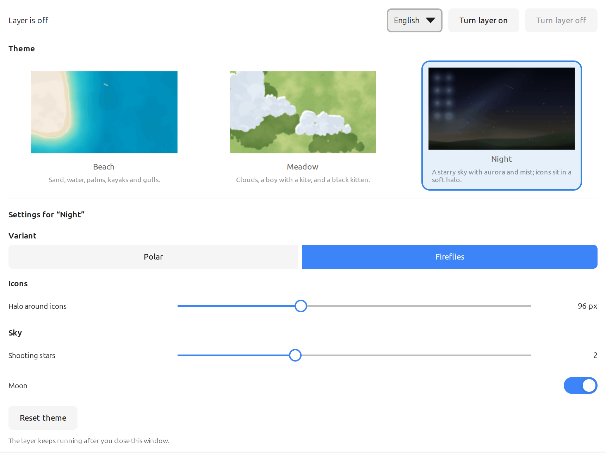
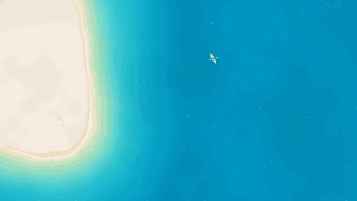
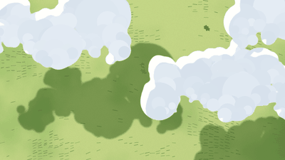
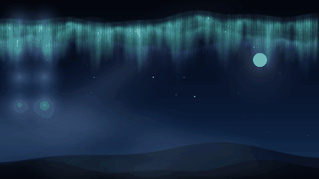
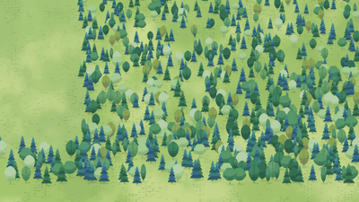

# Mintland on Linux Mint (Cinnamon/X11)

*[Русская версия](README.md)*

A port of the Windows program [Deskland](https://github.com/BLEZZ0102/Deskland)
to Linux Mint (Cinnamon / X11). Deskland draws adaptive wallpaper: the scene
reacts to the positions of your desktop icons.

**Status:** functional version v0.3 — beach and meadow behind the icons, icons
stay clickable, on/off works repeatedly, auto-pause, a graphical theme switcher.

Measured on an ASUS Vivobook X1502ZA laptop (Intel Core i7-12700H, 14 cores /
20 threads, 2560×1440): an active scene takes **~65% of one core, i.e. ~3.2% of
total CPU**; paused — **~0.5% of one core, i.e. ~0.02% of total**. This does not
mean "the CPU is 65% busy": roughly one core out of twenty is occupied.

**Wayland:** not supported yet. The engineering plan for the port (layer-shell,
`nemo-desktop` in `BOTTOM`, auto-pause via `cinnamon-list-windows`, risks and
tests) — see [`docs/en/WAYLAND.md`](docs/en/WAYLAND.md).

---

## What it looks like

**Control panel** — the shortcut "Mintland — themes and settings":
---

---
**Themes** — animated previews (GIF):

| Beach | Meadow | Night | Forest |
|---|---|---|---|
|  |  |  |  |

*The previews are recorded from these same scenes; on the Deskland website the
top block is a live WebGL iframe, not a video file.*

## What works

- The `flat.html` scene (beach) is drawn **under** the Nemo desktop icons.
- Icons stay visible and clickable (`nemo-desktop` is raised above the layer).
- Icon positions are read from gvfs metadata (`gio`) plus `desktop-metadata`
  (Computer, Trash, volumes) — the scene flows around them.
- Auto-pause when a window is maximised or fullscreen (EWMH) → <1% of one core:
  while paused the `requestAnimationFrame` loop stops rather than skipping
  frames.
- `switcher.py` is the single control point: theme selection, turning the layer
  on and off, sliders for animation parameters. Changes apply live.
- The Meadow theme has a boy with a kite and a black kitten: PNG sprites live in
  `prototype/assets/` and are loaded into the scene (WebKit is allowed `file://`
  access for this).
- One shortcut on the desktop — **"Mintland — themes and settings"**. Everything
  is controlled from the app. There is no tray icon yet; the state is visible in
  the scene and in `run/wall.log`.
- The Dark Mode applet is untouched (no `gsettings`/`dconf` calls).

## Architecture

```
┌─────────────────────────────────────────────────────────────┐
│ root window (X11)                                           │
│  ├─ csd-background: system wallpaper                        │
│  ├─ themehost.py: DESKTOP window + keep_below               │
│  │     └─ WebKit: flat.html?wallpaper=1 (the scene)         │
│  └─ nemo-desktop: icons (raised above the layer via -u)     │
└─────────────────────────────────────────────────────────────┘
```

- `themehost.py`: GTK3 + WebKit2 4.1. A window with type `DESKTOP` and
  `keep_below` drops into the desktop layer below normal windows; WebKit draws
  the scene. After launch, `deskwall -u` raises the `nemo-desktop` window, so the
  icons end up above the scene and stay clickable. The Mintland protocol: the
  host sends `{t:'icons', vis, r:[[l,t,r,b],...]}` and `{t:'pause', v}`; the
  page also understands `settings`/`reset`.
- `deskwall.c` → `bin/deskwall` (built locally): an X11 utility. Only `-u` is
  used now — raise `nemo-desktop` above the layer. The other modes are kept as
  experiments: `-r 0xWINID` (restack a window below nemo), `--` (fork a command
  with the WID substituted), `--create` (an empty DESKTOP container);
  `themehost.py` does not use them.
- `iconsource.py`: icon rectangles from `gio metadata::nemo-icon-position` plus
  virtual icons from `~/.config/nemo/desktop-metadata`, grid
  `desktop-grid-adjust`.
- `start-layer.sh`: launches the host (WebKit hardware acceleration).
- `switcher.py`: the GTK3 switcher. Keeps the choice in
  `~/.config/mintland/settings.json` and writes `run/control.json`;
  `themehost.py` reads the control file, switches the HTML theme and sends
  `settings` to the page.
- `wall-on.sh` / `wall-off.sh`: service scripts that start and stop the layer;
  `switcher.py` calls them (you can also run them by hand). `wall-on.sh` stops
  any old `themehost` before starting (no duplicate is left) and raises nemo once
  the layer window appears; `wall-off.sh` removes the layer and restarts
  `nemo-desktop` so the icons are guaranteed to come back.

## Performance (exact measurements)

**On units.** Every percentage "per core" below is the load of **one logical
core**, not of the whole processor. That is how `top`/`htop` report a single
process by default. To get a share of the whole machine, divide by the number of
threads (20 here). So "65%" means "~0.65 of one core out of 20", not "the CPU is
65% busy".

Method: the sum of `utime+stime` for `themehost.py` and its children
(`WebKitWebProcess`, `WebKitNetworkProcess`) from `/proc/<pid>/stat` over a
12–15 second window; one core = 100%. Test machine: **ASUS Vivobook X1502ZA
laptop, Intel Core i7-12700H (14 cores / 20 threads), 16 GB RAM, Linux Mint
Cinnamon/X11, 2560×1440, flat.html theme, 30 fps**.

| Theme | Scene active (one core) | Share of all CPU (20 threads) | Paused (one core) |
|---|---:|---:|---:|
| Beach (`flat.html`, WebGL) | **~65%** | **~3.2%** | ~0.5% |
| Night (`night.html`, canvas 2D) | **~50%** | **~2.5%** | ~0.4% |

For comparison: the old "12–20%" figures from the first measurements are also
percentages of one core, i.e. 0.6–1.0% of total load. The new numbers are higher
per core because the scene is now rendered through hardware GL rather than
software.

What accounts for the difference, and what is already optimised:

- while paused `requestAnimationFrame` is no longer scheduled — WebKit does not
  wake the compositor 30 times a second;
- icon positions are polled every 2 s, pause state every 1 s; the type and state
  of the active window are read with a single `xprop` call instead of two;
- the active scene is a full-screen WebGL surface at 2560×1440 and 30 fps
  (`cap30`), so about two thirds of a core go into rasterisation and compositing;
- in the Night theme the aurora is drawn into a reduced buffer and refreshed
  about 7 times a second, and the scene is not rendered at physical pixel
  density — that brought the frame down from ~12 to ~2.5 ms (measurement:
  `tools/bench-theme.py`).

Software rendering (`LIBGL_ALWAYS_SOFTWARE=1`) turned out **worse** on this
machine: ~200% of one core even while paused. Hardware GL through Mesa is the
workable option.

## Files

| File | Purpose |
|---|---|
| `deskwall.c` | C utility: `-u` raises nemo above the layer; `-r`, `--`, `--create` are experimental |
| `iconsource.py` | Icon positions: `gio` + `desktop-metadata`, grid `desktop-grid-adjust` |
| `themehost.py` | GTK3+WebKit2 host: DESKTOP window, WebKit, `icons`/`pause`/`settings` protocol |
| `switcher.py` | GTK3 theme and parameter switcher, layer on/off |
| `prototype/` | Themes and assets: `flat.html` (beach), `meadow.html` (meadow), `night.html` (night, no assets), `themes.json`, `assets/`, `thumbs/` |
| `start-layer.sh` | Launches the host (default theme `flat.html`; selection in `switcher.py`) |
| `wall-on.sh` / `wall-off.sh` | Service start/stop (called by `switcher.py`); restarts nemo after removing the layer |
| `README.md` | The Russian documentation (the only `.md` in the root) |
| `README.en.md` | This file |
| `tools/` | GIF preview capture, theme contract check, icon grid frame |
| `docs/` | All other documentation, animated previews and the panel screenshot |
| `docs/THEMES.md` | Theme contract and how to add a new one |
| `docs/WAYLAND.md` | Wayland port plan: layer-shell, risks, tests, estimate |
| `docs/WOLOLAND.md` | Analysis of another project (Wololand): what to adopt and what not |
| `docs/IMPROVEMENTS.md` | Concrete improvements from that analysis, with measurements and order of work |
| `docs/PAPER.md` | The idea of object themes ("a map on paper"): engine, art, stages |
| `docs/OCCLUSION.md` | How Cinnamon and Muffin stack windows: layers, order, why icons end up under the scene |
| `docs/SAFETY.md` | Safety contract (Dark Mode, kill policy) |
| `docs/en/` | English translations of the documents above |
| `LICENSE` | Full text of GNU GPL v3.0 |
| `NOTICE` | Deskland attribution and trademark notice |
| `.gitignore` | Excludes `bin/`, `run/`, `__pycache__` |

**Not in the repository:** `bin/deskwall` is a locally built binary (`bin/` is in
`.gitignore`); the `.desktop` shortcut and the symlink in `~/.local/bin` are also
created on the system. `run/control.json` and `~/.config/mintland/settings.json`
are the app's working files and are not committed. Build instructions are below.

## Launching the app

- `Mintland-настройки.desktop` → `~/.local/bin/mintland-settings.sh` → `switcher.py`

The shortcut and symlink are created on the system; they are not in the
repository. `wall-on.sh` / `wall-off.sh` are the service scripts the app calls
when the buttons are pressed.

## The Mintland app

Launch: the **"Mintland — themes and settings"** shortcut, or `python3
switcher.py`.

- cards for the ready themes from `prototype/themes.json` (Beach, Meadow, Night, Forest)
  with animated GIF previews;
- **Turn layer on** / **Turn layer off** buttons;
- parameter sliders for the selected theme: palms, kayaks, gulls, clouds,
  characters, aurora, mist;
- changes go straight to the running `themehost.py` through `run/control.json`;
- the selection and parameters are saved in `~/.config/mintland/settings.json`;
- if the layer is off, the selected theme applies the next time it is turned on;
- in the Meadow theme the boy and the kitten are toggled under "Characters";
- in the Night theme — aurora, meteors, moon and mist;
- in the Forest theme — trees of seven kinds on grass drawn with strokes; your
  icons sit in clearings, and trees that ended up under an icon sink into the
  ground and grow back;
- the interface language switch is in the status row: Russian (the development
  language) and English. The choice is stored in `~/.config/mintland/lang`;
  without a saved choice the language comes from `LANG`.

Themes with status `locked` in `themes.json` (Maldives, City and so on) are not
available in this build — they have no HTML pages.

How to add your own theme — see [`docs/en/THEMES.md`](docs/en/THEMES.md). What
could be improved and in what order — [`docs/en/IMPROVEMENTS.md`](docs/en/IMPROVEMENTS.md).

## Safety (Dark Mode)

The Dark Mode applet owns the dconf keys (including the wallpaper
`picture-uri`). Mintland scripts **never** call `gsettings`/`dconf`.

Kill policy: only our own processes are killed (`themehost` and old `deskwall`
processes); `wall-off.sh` additionally and deliberately restarts `nemo-desktop`
after removing the layer — that brings the icons back and does not touch Dark
Mode (icon positions live in gvfs metadata).

## Building

```bash
# 1. Build deskwall (bin/ is in .gitignore, the binary is not committed)
mkdir -p bin
cc -O2 -Wall deskwall.c -lX11 -lXext -o bin/deskwall

# 2. Dependencies (Debian/Ubuntu/Mint):
#    sudo apt install python3-gi python3-cairo python3-pil gir1.2-gtk-3.0 \
#         gir1.2-webkit2-4.1 libglib2.0-bin libnotify-bin \
#         x11-utils x11-xserver-utils webp-pixbuf-loader
#    For building: gcc libx11-dev libxext-dev
#    mpv/xwinwrap are not used.
```

## Roadmap

- [x] Step 1: layer under the icons (deskwall) — verified
- [x] Step 2: icon positions from gio → JSON
- [x] Step 3: Electron/WebKit skeleton with flat.html
- [x] Step 4: pause (EWMH) — verified, <1% of one core with a maximised window
- [x] Step 5: icons above the scene and clickable; on/off/on cycle — verified
- [x] Step 6: graphical theme switcher (Beach/Meadow/Night), on/off and parameters — MVP
- [x] Step 7: theme contract, check tools and preview capture (`THEMES.md`, `tools/`)
- [ ] Step 8: autostart, tray, .deb/AppImage
- [ ] Step 9: front click-through layer (a bonus above the icons)

## Known limitations

- It currently works in an X11 session. The Wayland port plan is in
  [`docs/en/WAYLAND.md`](docs/en/WAYLAND.md).
- Primary monitor only.
- `nemo-desktop` must be running **before** the layer; otherwise Nemo refuses the
  desktop role ("Desktop already managed by another application").
- After turning the layer off, `wall-off.sh` restarts `nemo-desktop` — this
  brings the icons back and prepares a clean start for the next time.
- WebKit runs through Mesa hardware acceleration (WebGL2). Software rendering
  (`LIBGL_ALWAYS_SOFTWARE=1` + `WEBKIT_DISABLE_COMPOSITING_MODE=1`) is not
  recommended: on this machine it gave ~200% of one core even while paused.
- An active scene noticeably loads **one core** (~65%); on a 20-thread machine
  that is ~3% of total CPU, not 65% of the whole processor. On battery it makes
  sense to keep a window maximised — auto-pause kicks in (~0.5% of one core,
  ~0.02% of total).
- `switcher.py` shows only themes with status `ready` and an existing HTML page;
  `locked` Deskland themes are not available in this build.
- Theme previews need the WebP loader for GdkPixbuf (`webp-pixbuf-loader`);
  without it the cards show a fallback icon, but switching still works.

## Licence

Mintland is distributed under **GNU GPL v3.0**; the full text is in
[`LICENSE`](LICENSE). The Deskland code and assets (the original) are GPL-3.0;
the `prototype/` directory is a derivative work, so the project as a whole stays
GPL-3.0. Attribution and the trademark notice are in [`NOTICE`](NOTICE).

The name "Deskland" and the original icon are not licensed as trademarks — this
project uses its own name, "Mintland".
