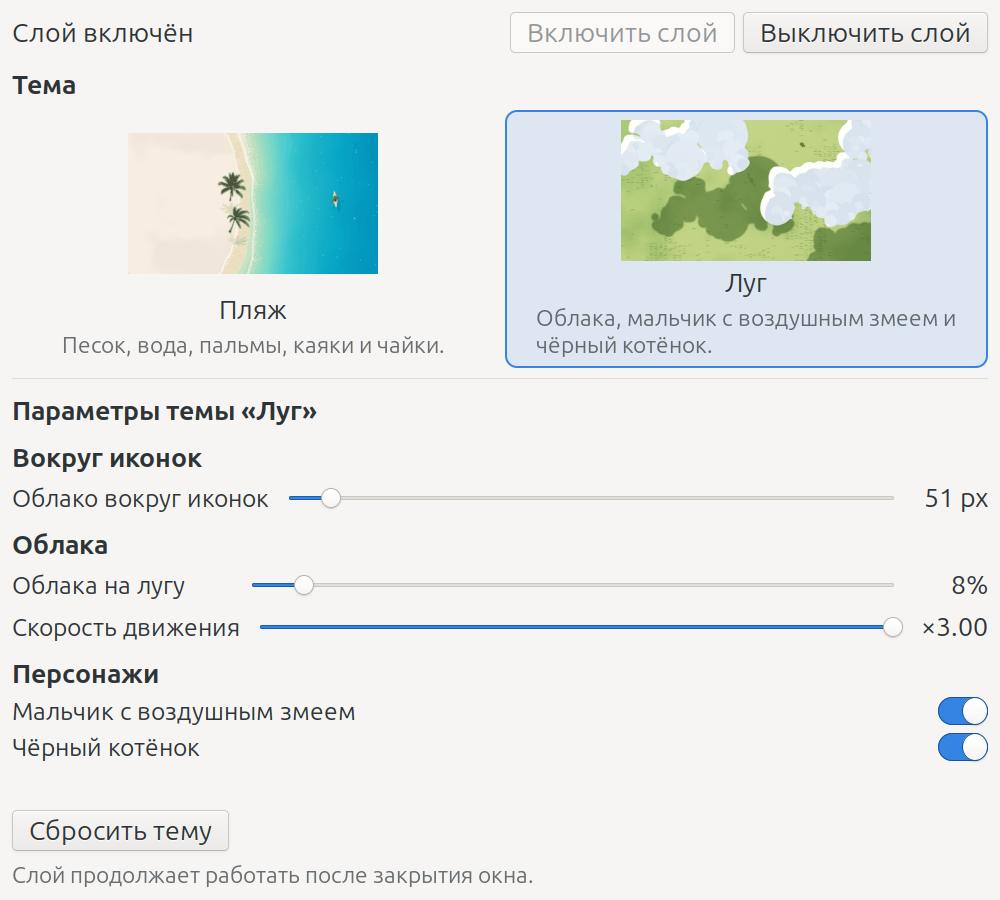

# Mintland на Linux Mint (Cinnamon/X11)

Проект: порт Windows-программы [Deskland](https://github.com/BLEZZ0102/Deskland)
(адаптивные обои, сцена реагирует на позиции иконок рабочего стола) под
Linux Mint (Cinnamon / X11).

**Статус:** функциональная версия v0.3 (пляж и луг под иконками, иконки
кликабельны, вкл/выкл работают повторно, авто-пауза, графический переключатель
тем).
Замерено на ноутбуке
ASUS Vivobook X1502ZA (Intel Core i7-12700H, 14 ядер / 20 потоков,
2560×1440): активная сцена — **~65% одного ядра, то есть ~3.2% общей
загрузки CPU**; пауза — **~0.5% одного ядра, то есть ~0.02% общей**.
Это не «процессор загружен на 65%»: занято примерно одно ядро из двадцати.

---

## Как это выглядит

**Панель управления** — ярлык «Mintland — темы и настройки»:
---

---
**Темы** — превью из репозитория Deskland:

| Пляж | Луг |
|---|---|
|  |  |

## Что работает

- Сцена `flat.html` (пляж) рисуется **под иконками** рабочего стола Nemo.
- Иконки остаются видимыми и кликабельными (nemo-desktop поверх слоя).
- Позиции иконок читаются из gvfs-метаданных (`gio`) + `desktop-metadata`
  (Компьютер, Корзина, тома) — сцена обтекает их.
- Авто-пауза при развёрнутом/полноэкранном окне (EWMH) → <1% одного ядра:
  на паузе цикл `requestAnimationFrame` останавливается, а не просто пропускает кадры.
- Приложение `switcher.py` — единственная точка управления: выбор темы,
  включение и выключение слоя, ползунки параметров анимации. Изменения
  применяются на лету.
- В теме Meadow есть мальчик с воздушным змеем и чёрный котёнок: PNG-спрайты
  лежат в `prototype/assets/` и загружаются в сцену (для этого WebKit разрешён
  доступ к файлам `file://`).
- На рабочем столе один ярлык — **«Mintland — темы и настройки»**. Всё
  управление находится в приложении. Трея пока нет — состояние видно по сцене
  и в `run/wall.log`.
- Апплет Dark Mode не затрагивается (никаких gsettings/dconf).

## Архитектура

```
┌─────────────────────────────────────────────────────────────┐
│ root window (X11)                                           │
│  ├─ csd-background: системные обои                          │
│  ├─ themehost.py: окно DESKTOP + keep_below                 │
│  │     └─ WebKit: flat.html?wallpaper=1 (сцена)             │
│  └─ nemo-desktop: иконки (поднят поверх слоя через -u)      │
└─────────────────────────────────────────────────────────────┘
```

- `themehost.py`: GTK3 + WebKit2 4.1. Окно с типом `DESKTOP` и `keep_below`
  уходит в слой рабочего стола ниже обычных окон; WebKit рисует сцену.
  После запуска `deskwall -u` поднимает окно `nemo-desktop`, поэтому иконки
  оказываются поверх сцены и остаются кликабельными. Протокол Mintland:
  хост отправляет `{t:'icons', vis, r:[[l,t,r,b],...]}` и `{t:'pause', v}`;
  страница также понимает `settings`/`reset` (задел под `settings.html`).
- `deskwall.c` → `bin/deskwall` (собирается локально): X11-утилита.
  Сейчас используется только `-u` — поднять `nemo-desktop` поверх слоя.
  Остальные режимы оставлены как экспериментальные: `-r 0xWINID` (restack
  окна ниже nemo), `--` (форк команды с подстановкой WID), `--create`
  (пустой DESKTOP-контейнер); текущий `themehost.py` их не использует.
- `iconsource.py`: прямоугольники иконок из `gio metadata::nemo-icon-position`
  + виртуальные иконки из `~/.config/nemo/desktop-metadata`, сетка `desktop-grid-adjust`.
- `start-layer.sh`: запуск хоста (аппаратное ускорение WebKit).
- `switcher.py`: GTK3-переключатель. Хранит выбор в
  `~/.config/mintland/settings.json` и пишет `run/control.json`; `themehost.py`
  читает control-файл, переключает HTML-тему и отправляет странице `settings`.
- `wall-on.sh` / `wall-off.sh`: служебные скрипты запуска и остановки, их
  вызывает `switcher.py` (можно и вручную). `wall-on.sh` завершает старый
  `themehost` перед запуском (дубля не остаётся) и поднимает nemo после
  появления окна слоя; `wall-off.sh` снимает слой и перезапускает
  `nemo-desktop`, чтобы иконки гарантированно вернулись.

## Производительность (точные замеры)

**Важно про единицы.** Все проценты «на одно ядро» — это загрузка **одного
логического ядра**, а не всего процессора. Именно так по умолчанию считает
`top`/`htop` для отдельного процесса. Чтобы получить долю от всей машины,
нужно разделить на число потоков (здесь — 20). Поэтому «65%» означает
«занято ~0.65 ядра из 20», а не «CPU загружен на 65%».

Методика: сумма `utime+stime` процессов `themehost.py` и его потомков
(`WebKitWebProcess`, `WebKitNetworkProcess`) по `/proc/<pid>/stat` за окно
12–15 секунд; 1 ядро = 100%. Тестовая машина: **ноутбук ASUS Vivobook
X1502ZA, Intel Core i7-12700H (14 ядер / 20 потоков), 16 ГБ RAM,
Linux Mint Cinnamon/X11, 2560×1440, тема flat.html, 30 fps**.

| Состояние | Загрузка одного ядра (как в `top`) | Доля от всего CPU (20 потоков) |
|---|---:|---:|
| Сцена активна (рабочий стол в фокусе) | **~65%** | **~3.2%** |
| Пауза (развёрнутое/полноэкранное окно) | **~0.5%** | **~0.02%** |

Для сравнения: старые «12–20%» из первых замеров — это тоже проценты одного
ядра, то есть 0.6–1.0% общей загрузки. Новые цифры выше по одному ядру,
потому что сцена теперь рендерится через аппаратный GL, а не софтверный.

Что даёт такую разницу и что уже оптимизировано:

- на паузе `requestAnimationFrame` больше не планируется — WebKit не будит
  композитор 30 раз в секунду;
- позиции иконок опрашиваются раз в 2 с, пауза — раз в 1 с; тип и состояние
  активного окна читаются одним вызовом `xprop` вместо двух;
- активная сцена — это полноэкранный WebGL на 2560×1440 при 30 fps
  (`cap30`), поэтому ~2/3 ядра уходит на растеризацию и композитинг.

Софтверный рендер (`LIBGL_ALWAYS_SOFTWARE=1`) на этой машине оказался
**хуже**: ~200% одного ядра даже на паузе. Аппаратный GL через Mesa — рабочий
вариант.

## Файлы

| Файл | Назначение |
|---|---|
| `deskwall.c` | C-утилита: `-u` поднимает nemo поверх слоя; `-r`, `--`, `--create` — экспериментальные режимы |
| `iconsource.py` | Позиции иконок: `gio` + `desktop-metadata`, сетка `desktop-grid-adjust` |
| `themehost.py` | GTK3+WebKit2 хост: окно DESKTOP, WebKit, протокол `icons`/`pause`/`settings` |
| `switcher.py` | GTK3-переключатель тем и параметров, вкл/выкл слоя |
| `prototype/` | Темы и ассеты (из Deskland): `flat.html` (пляж), `meadow.html`, `settings.html`, `themes.json`, `assets/`, `i18n/`, `thumbs/` |
| `start-layer.sh` | Запуск хоста (тема по умолчанию `flat.html`; выбор — в `switcher.py`) |
| `wall-on.sh` / `wall-off.sh` | Служебные запуск/остановка (вызывает `switcher.py`); перезапуск nemo после снятия слоя |
| `README.md` | Эта документация |
| `docs/` | Превью тем и скриншот панели для README |
| `SAFETY.md` | Контракт безопасности (Dark Mode, kill-политика) |
| `LICENSE` | Полный текст GNU GPL v3.0 |
| `NOTICE` | Атрибуция Deskland и trademark-оговорка |
| `.gitignore` | Исключает `bin/`, `run/`, `__pycache__` |

**Чего в репозитории нет:** `bin/deskwall` — это локально собранный бинарник
(`bin/` в `.gitignore`); ярлык `.desktop` и symlink в `~/.local/bin` тоже
создаются в системе. `run/control.json` и `~/.config/mintland/settings.json` —
рабочие файлы приложения, они не коммитятся. Инструкция по сборке — ниже.

## Запуск приложения

- `Mintland-настройки.desktop` → `~/.local/bin/mintland-settings.sh` → `switcher.py`

Ярлык и symlink создаются в системе; в репозитории их нет. `wall-on.sh` /
`wall-off.sh` — служебные скрипты, которые приложение вызывает при нажатии
кнопок.

## Приложение Mintland

Запуск: ярлык **«Mintland — темы и настройки»** или `python3 switcher.py`.

- карточки готовых тем из `prototype/themes.json` (сейчас Beach и Meadow);
- кнопки **Включить слой** / **Выключить слой**;
- ползунки параметров выбранной темы: пальмы, каяки, чайки, облака, персонажи;
- изменения сразу уходят работающему `themehost.py` через `run/control.json`;
- выбор и параметры сохраняются в `~/.config/mintland/settings.json`;
- если слой выключен, выбранная тема применится при следующем включении;
- в теме Meadow мальчик и котёнок включаются переключателями «Персонажи».

Темы со статусом `locked` в `themes.json` (Мальдивы, Лес, Город и т.д.) в этой
сборке недоступны — для них нет HTML-страниц.

## Безопасность (Dark Mode)

Апплет Dark Mode владеет ключами dconf (включая обои `picture-uri`).
Скрипты Mintland **никогда** не вызывают `gsettings`/`dconf`.
Kill-политика: убиваются только собственные процессы (themehost и старые
процессы deskwall); `wall-off.sh` дополнительно намеренно
перезапускает `nemo-desktop` после снятия слоя — это возвращает иконки и не
затрагивает Dark Mode (позиции иконок хранятся в gvfs-метаданных).

## Сборка

```bash
# 1. Собрать deskwall (bin/ в .gitignore, бинарник в репозиторий не входит)
mkdir -p bin
cc -O2 -Wall deskwall.c -lX11 -lXext -o bin/deskwall

# 2. Зависимости (Debian/Ubuntu/Mint):
#    sudo apt install python3-gi python3-cairo gir1.2-gtk-3.0 \
#         gir1.2-webkit2-4.1 libglib2.0-bin libnotify-bin \
#         x11-utils x11-xserver-utils webp-pixbuf-loader
#    Для сборки: gcc libx11-dev libxext-dev
#    mpv/xwinwrap не используются.
```

## Дорожная карта

- [x] Шаг 1: слой под иконками (deskwall) — проверено
- [x] Шаг 2: позиции иконок из gio → JSON
- [x] Шаг 3: Electron/WebKit-скелет с flat.html
- [x] Шаг 4: пауза (EWMH) — проверено, <1% одного ядра при развёрнутом окне
- [x] Шаг 5: иконки поверх сцены и кликабельны; цикл вкл/выкл/вкл — проверено
- [x] Шаг 6: графический переключатель тем (Beach/Meadow), вкл/выкл и параметры — MVP
- [ ] Шаг 7: расширенный редактор (settings.html), пресеты, автозапуск, трей, .deb/AppImage
- [ ] Шаг 8: передний кликопрозрачный слой (бонус над иконками)

## Известные ограничения

- Работает только в X11-сессии (Wayland не поддерживается).
- Только основной монитор.
- `nemo-desktop` должен быть запущен **до** слоя; иначе Nemo отказывается
  от роли рабочего стола («Desktop already managed by another application»).
- После выключения слоя `wall-off.sh` перезапускает `nemo-desktop` — это
  возвращает иконки и готовит чистый старт для следующего включения.
- WebKit работает через аппаратное ускорение Mesa (WebGL2). Софтверный рендер
  (`LIBGL_ALWAYS_SOFTWARE=1` + `WEBKIT_DISABLE_COMPOSITING_MODE=1`) не
  рекомендуется: на этой машине он дал ~200% одного ядра даже на паузе.
- Активная сцена заметно нагружает **одно ядро** (~65%); на 20-поточной машине
  это ~3% общей загрузки CPU, а не 65% всего процессора. Для ноутбука от
  батареи имеет смысл держать окно развёрнутым — сработает авто-пауза
  (~0.5% одного ядра, ~0.02% общей).
- `switcher.py` показывает только темы со статусом `ready` и существующей
  HTML-страницей; `locked`-темы из Deskland в этой сборке недоступны.
- Для превью тем нужен WebP-загрузчик GdkPixbuf (`webp-pixbuf-loader`);
  без него карточки покажут запасную иконку, но переключение работает.

## Лицензия

Mintland распространяется под **GNU GPL v3.0**; полный текст — в [`LICENSE`](LICENSE).
Код и ассеты Deskland (оригинал) — GPL-3.0; каталог `prototype/` — производная
работа, поэтому проект в целом остаётся GPL-3.0. Атрибуция и trademark-оговорка —
в [`NOTICE`](NOTICE).

Имя «Deskland» и иконка оригинала не лицензированы как trademark — проект
использует своё имя «Mintland».
