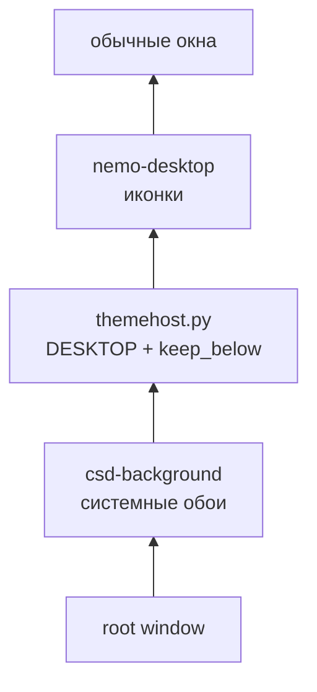
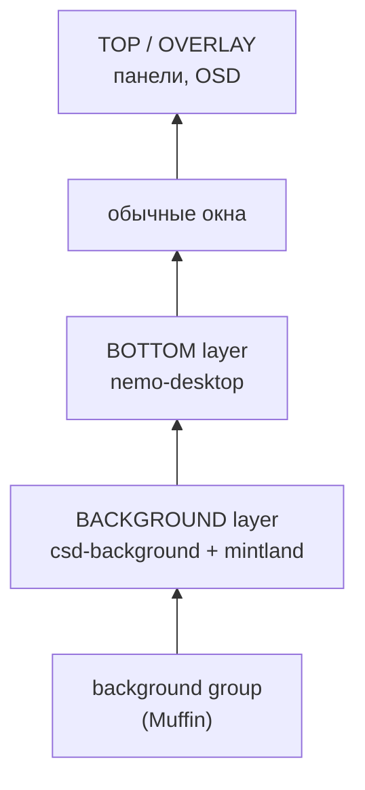

# Mintland на Wayland

**План порта для Cinnamon 6.8+ / Muffin 6.7.5+**

> Дата: 13.11.2026  
> Статус: исследование + инженерный план. На текущей машине Wayland-путь **не тестировался**: здесь X11, Cinnamon 6.6.9 и Muffin 6.6.3, в которых ещё нет layer-shell.  
> Короткий вывод: это не переписывание Mintland, а замена платформенного слоя. Сцены, `switcher.py`, `iconsource.py` и протокол `icons/pause/settings` переносятся. Основная работа — `themehost.py`, скрипты запуска и новая авто-пауза.

## Содержание

- [0. TL;DR](#0-tldr)
- [1. Что уже проверено](#1-что-уже-проверено)
- [2. Архитектура: как это работает сейчас и как должно работать](#2-архитектура-как-это-работает-сейчас-и-как-должно-работать)
- [3. Компонент-за-компонентом](#3-компонент-за-компонентом)
- [4. Код: двойной бэкенд](#4-код-двойной-бэкенд)
- [5. Спорные места и риски](#5-спорные-места-и-риски)
- [6. План тестов на Cinnamon 6.8](#6-план-тестов-на-cinnamon-68)
- [7. Оценка работ](#7-оценка-работ)
- [8. Рекомендуемый порядок работ](#8-рекомендуемый-порядок-работ)
  - [8.1. KDE Plasma: отдельный этап](#81-kde-plasma-отдельный-этап-не-входит-в-cinnamon-mvp)
- [9. Основные уточнения](#9-Основные-уточнения)
- [10. Ссылки](#10-ссылки)

---

## 0. TL;DR

- **Не надо переписывать всё.** HTML/WebGL-сцены, настройки, темы, GIF-превью, `switcher.py` и чтение позиций иконок от X11 не зависят.
- **`deskwall.c` на Wayland не нужен.** Иконки рисует `nemo-desktop`, который в Cinnamon 6.8 сам становится layer-shell-клиентом слоя `BOTTOM`. Сцена должна лежать в слое `BACKGROUND` — тогда иконки гарантированно выше.
- **`xprop` и `xwininfo` на Wayland не работают** для нативных окон. Авто-паузу надо переводить на `cinnamon-list-windows --json` или прямой D-Bus-вызов `org.cinnamon.Muffin.Debug.ListWindows`.
- **Главный риск — не код, а порядок внутри `BACKGROUND`.** Там же лежит `csd-background` (системные обои). Протокол не определяет порядок внутри одного слоя. Если `csd-background` окажется выше Mintland, сцену не будет видно. Это надо проверить первым делом.
- **Мультимонитор — не «почти даром».** Layer-shell даёт поверхность на output, но нужен отдельный `GtkWindow`/WebView на монитор, фильтрация иконок по монитору и учёт масштаба. Это отдельный этап.
- **KDE/GNOME — не целевые платформы.** На Kubuntu/KDE окно со сценой, вероятно, запустится (KWin поддерживает layer-shell), но без `nemo-desktop`, `iconsource` и `cinnamon-list-windows` это будут просто анимированные обои. Для GNOME layer-shell нет. Полноценный KDE-бэкенд — отдельный этап (см. §8.1).
- **Оценка:** 3–7 дней на одноэкранный MVP, если порядок слоёв сложится; 2–3 недели с HiDPI, мультимонитором и тестами. Если порядок `BACKGROUND` не сложится — plan B через Cinnamon-расширение/десклет, это ещё 1–2 недели.

---

## 1. Что уже проверено

### 1.1. Текущая машина

```text
$ echo $XDG_SESSION_TYPE
x11

$ cinnamon --version
Cinnamon 6.6.9

$ muffin --version
muffin 6.6.3

$ command -v cinnamon-list-windows
(нет)

$ command -v wayland-info
(нет)

$ ls /usr/lib/x86_64-linux-gnu/girepository-1.0/ | grep -i layer
(нет)
```

Отсюда важный вывод: **на этой машине порт нельзя проверить вживую**. Нужна сессия Cinnamon 6.8 / Muffin 6.7.5+ (следующий выпуск Mint, ожидается к концу 2026; в источниках встречаются номера Mint 23 и 27 — нумерация менялась). Всё ниже — анализ исходников upstream и план тестов, а не отчёт о живом запуске.

### 1.2. Upstream-факты

| Что | Факт | Источник |
|---|---|---|
| Muffin | Поддержка `wlr-layer-shell` появилась в 6.7.0; в 6.7.4 — v4; в 6.7.5 — v5, HiDPI-масштабирование поверхностей и исправления | [changelog](https://raw.githubusercontent.com/linuxmint/muffin/master/debian/changelog), [wayland.app](https://wayland.app/protocols/wlr-layer-shell-unstable-v1) |
| Cinnamon 6.8 | Wayland перестаёт быть «экспериментальным»; X11 остаётся полностью поддерживаемым | [Linux Mint Blog, июнь 2026](https://blog.linuxmint.com/?p=5046) |
| `nemo-desktop` | PR #3684 (merged 2026-03-02): на Wayland рисует иконки через `gtk-layer-shell`, слой `BOTTOM`, namespace `nemo-desktop`, `exclusive_zone=0` | [nemo#3684](https://github.com/linuxmint/nemo/pull/3684) |
| `csd-background` | PR #437 (merged 2026-03-02): системные обои на Wayland — layer-shell, слой `BACKGROUND`, namespace `csd-background`, `exclusive_zone=-1` | [cinnamon-settings-daemon#437](https://github.com/linuxmint/cinnamon-settings-daemon/pull/437) |
| `cinnamon-list-windows` | Новый CLI в Muffin 6.7.5: список окон, позиции, размеры, HiDPI, backend; внутри — D-Bus `org.cinnamon.Muffin.Debug.ListWindows`, есть `--json` | [muffin/src/cinnamon-list-windows](https://github.com/linuxmint/muffin/blob/master/src/cinnamon-list-windows) |
| Пакет GIR | В Debian/Ubuntu/Mint называется **`gir1.2-gtklayershell-0.1`**, а не `gir1.2-gtk-layer-shell-0` | `apt-cache search gtk-layer-shell` |
| `wayland-info` | Содержится в пакете **`wayland-utils`** | `apt-cache policy wayland-utils` |

### 1.3. Что поправить в ответе коллеги

Ответ в целом верный, но есть нюансы, которые лучше зафиксировать до начала работ:

1. **Пакет GIR называется иначе.** Для Python-GI нужен `gir1.2-gtklayershell-0.1`; `libgtk-layer-shell-dev` тянет его как зависимость, но в инструкции лучше писать правильное имя.
2. **В сниппете смешаны два API.** `GtkLayerShell.set_keyboard_interactivity()` ожидает `KeyboardInteractivity`, а `GtkLayerShell.KeyboardMode.NONE` — это `KeyboardMode`. В Python-GI правильно:
   ```python
   GtkLayerShell.set_keyboard_mode(window, GtkLayerShell.KeyboardMode.NONE)
   ```
3. **`nemo-desktop` — не «обычная поверхность», а `BOTTOM`-слой.** Это даже лучше: он гарантированно выше `BACKGROUND`, где будет Mintland. Но `deskwall -u` на Wayland не просто не нужен — он бессмысленен и может трогать XWayland-окна.
4. **Порядок `csd-background` и Mintland в `BACKGROUND` — главный неизвестный.** Протокол прямо говорит: порядок внутри одного слоя не определён. В Muffin он зависит от реализации `meta_wayland_background_actor_sync_clones()`. Это не «визуально неважно»: если `csd-background` окажется выше, Mintland будет не виден.
5. **Мультимонитор — не бесплатно.** Нужны отдельные поверхности/окна на каждый output, фильтрация иконок по монитору, согласование HiDPI. Это отдельный этап, а не побочный эффект.
6. **`cinnamon-list-windows` — это Python-скрипт над D-Bus.** Для опроса раз в секунду лучше вызывать D-Bus напрямую, без spawn Python. И надо проверить, что сервис `org.cinnamon.Muffin.Debug` доступен в релизной сборке, а не только в debug.
7. **XWayland-fallback ослепляет авто-паузу.** `xprop` внутри XWayland видит только X11-клиенты; нативное Wayland-окно на весь экран он не заметит, и сцена будет молотить CPU. Это допустимо как временный костыль, но не как решение.
8. **`GDK_BACKEND=wayland` обычно не нужен.** На Wayland-сессии GTK3 и так выбирает Wayland; переменная нужна только для принудительного выбора. Для Mintland важнее `GtkLayerShell.is_supported()` и проверка, что `nemo-desktop` действительно Wayland-клиент.
9. **`iconsource.py` жёстко ищет `~/Рабочий стол`.** На английской локали это `~/Desktop`; для переносимости лучше `xdg-user-dir DESKTOP` или `GLib.get_user_special_dir(GLib.UserDirectory.DIRECTORY_DESKTOP)`.
10. **`start-layer.sh` требует `bin/deskwall`.** На Wayland этой зависимости быть не должно; проверку надо сделать условной.

---

## 2. Архитектура: как это работает сейчас и как должно работать

### 2.1. X11 (текущая схема)



- `themehost.py` создаёт окно типа `DESKTOP`, опускает его `keep_below`.
- `nemo-desktop` рисует иконки поверх.
- `deskwall -u` поднимает `nemo-desktop`, чтобы Muffin не положил слой выше иконок.
- Авто-пауза — `xprop` по `_NET_ACTIVE_WINDOW`.

### 2.2. Wayland (целевая схема)



- `csd-background` и Mintland — оба `BACKGROUND`; `nemo-desktop` — `BOTTOM`; обычные окна выше.
- `deskwall` не нужен: порядок слоёв задаёт композитор.
- Иконки кликабельны, потому что `nemo-desktop` выше Mintland.
- Авто-пауза — список окон через `cinnamon-list-windows`/D-Bus, а не `xprop`.

> **Важно:** порядок внутри `BACKGROUND` протоколом не определён. В Muffin 6.7.x `meta_wayland_background_actor_sync_clones()` собирает клоны поверхностей в порядке, который зависит от реализации. Это надо проверить на живой Cinnamon 6.8: кто выше — `csd-background` или Mintland.

---

## 3. Компонент-за-компонентом

| Компонент | Сейчас | На Wayland | Работа |
|---|---|---|---|
| `prototype/*.html` | WebGL-сцены в WebKitGTK | Без изменений; WebKitGTK 4.1 работает на Wayland нативно | 0 |
| `themehost.py` — окно | `DESKTOP` + `keep_below` + `lower()` + `move()` | `gtk-layer-shell`: `BACKGROUND`, anchors, `exclusive_zone=-1`, `keyboard_mode=NONE` | 1–2 дня |
| `themehost.py` — иконки | `xprop`, `get_xid()`, `input_shape` | `get_xid()`/`xprop` убрать; input region через GDK; координаты — логические | 1–2 дня |
| `themehost.py` — пауза | `xprop _NET_ACTIVE_WINDOW` | `cinnamon-list-windows --json` или D-Bus `ListWindows` | 1–2 дня |
| `deskwall.c` | `-u` поднимает nemo | Не нужен; оставить только для X11 | 0.5 дня на развилку |
| `wall-on.sh` | `xwininfo` ждёт окно; `deskwall -u` | Ждать `run/ready`; не вызывать `deskwall` | 0.5–1 день |
| `wall-off.sh` | kill + перезапуск nemo | Перезапуск nemo, скорее всего, не нужен; проверить | 0.5 дня |
| `start-layer.sh` | Требует `bin/deskwall` | На Wayland не требовать | 0.5 дня |
| `iconsource.py` | `gio` + `desktop-metadata` | Работает; поправить `XDG_DESKTOP_DIR` и DPI | 0.5–1 день |
| `switcher.py` | GTK3, GIF-превью | Работает; можно показать backend | 0.5 дня |
| Мультимонитор | Только основной | Отдельная поверхность на output | 2–5 дней |
| Тесты | X11 | Нужна машина с Cinnamon 6.8 | 3–5 дней |

> Таблица — для Cinnamon. Для KDE Plasma и GNOME состав компонентов другой: layer-shell есть не везде, а иконки, авто-пауза и системные обои устроены иначе. См. §5.9 и §8.1.

---

## 4. Код: двойной бэкенд

### 4.1. `themehost.py`: настройка окна

Идея: оставить один `ThemeHost`, но перед `show_all()` выбрать платформенный путь.

```python
import os

IS_WAYLAND = os.environ.get("XDG_SESSION_TYPE") == "wayland"

def _setup_window(self):
    if IS_WAYLAND:
        try:
            gi.require_version("GtkLayerShell", "0.1")
            from gi.repository import GtkLayerShell
        except (ValueError, ImportError):
            raise RuntimeError("gtk-layer-shell GIR не установлен")

        if not GtkLayerShell.is_supported():
            raise RuntimeError("композитор не поддерживает wlr-layer-shell")

        GtkLayerShell.init_for_window(self.win)
        GtkLayerShell.set_layer(self.win, GtkLayerShell.Layer.BACKGROUND)
        GtkLayerShell.set_namespace(self.win, "mintland")
        GtkLayerShell.set_keyboard_mode(
            self.win, GtkLayerShell.KeyboardMode.NONE)
        GtkLayerShell.set_exclusive_zone(self.win, -1)
        for edge in (GtkLayerShell.Edge.TOP, GtkLayerShell.Edge.BOTTOM,
                     GtkLayerShell.Edge.LEFT, GtkLayerShell.Edge.RIGHT):
            GtkLayerShell.set_anchor(self.win, edge, True)
        if self.monitor is not None:
            GtkLayerShell.set_monitor(self.win, self.monitor)
    else:
        self.win.set_type_hint(Gdk.WindowTypeHint.DESKTOP)
        self.win.set_keep_below(True)
```

Что **не** делать на Wayland:

- `gtk_window_move()` — позиция задаётся anchors;
- `gdk_window_lower()` — слой задаёт композитор;
- `gdk_window_get_xid()` — XID есть только у X11/XWayland;
- `gtk_window_set_type_hint(DESKTOP)` и `set_keep_below()` — не имеют смысла;
- `deskwall -u` — нельзя рестэкать чужие окна.

### 4.2. Input region: клики должны проходить

Для обоев сцена не должна перехватывать ввод. На X11 сейчас используется `input_shape_combine_region` с пустой областью. На Wayland у GDK3 есть поддержка input region для собственной поверхности; проверить на Muffin 6.8.

```python
gdkwin = self.win.get_window()
if gdkwin is not None:
    empty = cairo.Region()
    # Вариант 1: window-level
    gdkwin.input_shape_combine_region(empty, 0, 0)
    # Вариант 2, если GTK перезатирает форму: widget-level
    # self.win.input_shape_combine_region(empty)
```

> Если input region на Wayland behaviour окажется нестабильным, это не блокер для иконок: `nemo-desktop` всё равно выше Mintland и получает клики. Но пустая область желательна, чтобы сцена не мешала кликам по пустому месту и не ловила фокус.

### 4.3. Готовность слоя: `run/ready` вместо `xwininfo`

На Wayland у layer-surface нет X-окна, поэтому `xwininfo -root -tree | grep mintland` не сработает. Простейший контракт:

```python
# themehost.py
def _on_map(self, *_):
    (RUN / "ready").write_text("1", encoding="utf-8")
    return False

self.win.connect("map-event", self._on_map)
```

```bash
# wall-on.sh
rm -f "$RUN/ready"
bash "$DIR/start-layer.sh" >>"$LOG" 2>&1
for _ in $(seq 1 40); do
    [ -f "$RUN/ready" ] && break
    sleep 0.25
done
[ -f "$RUN/ready" ] || { say "Слой не поднялся"; exit 1; }
```

На X11 можно оставить старую проверку или тоже перейти на `run/ready` — так проще.

### 4.4. Координаты иконок: логические пиксели

Сейчас `iconsource.collect()` возвращает логические пиксели, `themehost.py` умножает их на `self.scale`, а страница делит на `window.devicePixelRatio`. Это двойное преобразование, которое на Wayland с дробным масштабом легко рассинхронизировать.

Лучше добавить в протокол явный признак единиц:

```json
{"t":"icons","vis":true,"unit":"logical","r":[[l,t,r,b], ...]}
```

И поправить страницу (`flat.html`, `meadow.html`):

```js
// было
const k = window.devicePixelRatio || 1;
// стало
const k = m.unit === 'logical' ? 1 : (window.devicePixelRatio || 1);
```

Тогда `themehost.py` отправляет логические координаты без умножения на `scale`, а `iconsource.py` остаётся в логических пикселях. Для HiDPI это надёжнее, чем угадывать `devicePixelRatio` WebKit.

Отдельно: `ThemeHost._detect_scale()` сейчас использует `xrandr`. На Wayland `xrandr` либо говорит с XWayland, либо вообще отсутствует; масштаб надо брать из `Gdk.Monitor.get_scale_factor()` (целый) и/или из `monitor-scale` в `cinnamon-list-windows --json` (дробный). Для 125/150% одного `Gdk` недостаточно — нужен второй источник.

### 4.5. Авто-пауза через D-Bus

`cinnamon-list-windows --json` — удобная отладка, но для опроса раз в секунду лучше вызвать D-Bus напрямую:

```python
from gi.repository import Gio, GLib

def list_windows():
    bus = Gio.bus_get_sync(Gio.BusType.SESSION, None)
    res = bus.call_sync(
        "org.cinnamon.Muffin.Debug",
        "/org/cinnamon/Muffin/Debug",
        "org.cinnamon.Muffin.Debug",
        "ListWindows",
        None,
        GLib.VariantType.new("(aa{sv})"),
        Gio.DBusCallFlags.NONE,
        1000,
        None,
    )
    windows, = res.unpack()
    return windows


def covers_monitor(win, mon):
    if not win.get("mapped") or win.get("hidden"):
        return False
    rect = win.get("frame-rect")
    if not rect:
        return False
    x, y, w, h = rect
    return (x <= mon.x and y <= mon.y and
            x + w >= mon.x + mon.width and
            y + h >= mon.y + mon.height)
```

Практические детали:

- `frame-rect` — логические координаты; монитор берите из `Gdk.Monitor.get_geometry()`/`get_workarea()`.
- Фильтруйте `window-type`: `DESKTOP` (Nemo) и `DOCK` (панели) не должны ставить сцену на паузу.
- Фильтруйте `monitor` — на мультимониторе каждый экземпляр Mintland должен смотреть только свой монитор.
- `hidden`, `mapped`, `workspace` — использовать, чтобы не реагировать на свёрнутые/чужие рабочие столы.
- Если `org.cinnamon.Muffin.Debug` недоступен в релизной сборке, fallback: `cinnamon-list-windows --json` (если команда работает) или Cinnamon-расширение.

> Mintland в слое `BACKGROUND` не создаёт `MetaWindow` (в Muffin `layer_wants_window()` возвращает `false` для `BACKGROUND`), поэтому в `ListWindows` его не будет. Фильтр «игнорировать собственное окно по PID/XID» на Wayland не нужен — в отличие от X11, где `self.xid` сравнивается с `_NET_ACTIVE_WINDOW`.

### 4.6. Скрипты: развилка X11/Wayland

```bash
# start-layer.sh
if [ "${XDG_SESSION_TYPE:-}" = "x11" ]; then
    [ -x "$DIR/bin/deskwall" ] || notify_err "bin/deskwall не собран (см. deskwall.c)"
fi
```

```bash
# wall-on.sh
if [ "${XDG_SESSION_TYPE:-}" = "x11" ]; then
    for _ in 1 2 3; do
        "$DIR/bin/deskwall" -u 2>/dev/null || true
        sleep 0.5
    done
fi
```

```bash
# wall-off.sh — на Wayland сначала проверяем, нужен ли перезапуск nemo
if [ "${XDG_SESSION_TYPE:-}" = "x11" ]; then
    pkill -x nemo-desktop 2>/dev/null || true
    setsid nemo-desktop >/dev/null 2>&1 &
fi
```

`nemo-desktop` на Wayland — layer-shell-клиент; после исчезновения Mintland он должен остаться на месте. Перезапускать его стоит только если тест покажет, что иконки пропали.

---

## 5. Спорные места и риски

### 5.1. Порядок `csd-background` vs Mintland в `BACKGROUND`

**Риск:** оба — `BACKGROUND`; протокол не гарантирует порядок. В Muffin порядок зависит от реализации; если системные обои окажутся выше, Mintland не виден.

**Что делать:**

1. Первым тестом запустить `csd-background`, затем Mintland, и посмотреть, кто виден.
2. Проверить обратный порядок и перезапуск `csd-background` при работающем Mintland.
3. Если `csd-background` выше — варианты:
   - пере-создать/пере-поднять поверхность Mintland после изменений `csd-background`;
   - использовать Cinnamon-расширение/десклет, который вставляет сцену в `background_window_group` выше обоев, но ниже `bottom_window_group`;
   - в крайнем случае — небольшой патч Muffin с сортировкой по namespace (не рекомендуется для сопровождения).

### 5.2. `nemo-desktop` на Wayland

**Риск:** в Mint 23 `nemo-desktop` должен использовать `BOTTOM`-слой, но если пакет собран без `gtk-layer-shell` или композитор не поддерживает протокол, Nemo откатится на X11-бэкенд. Тогда иконки могут оказаться не в том слое.

**Проверка:**

```bash
wayland-info | grep -E 'zwlr_layer_shell_v1|zwlr_foreign_toplevel'
# в списке окон cinnamon-list-windows у nemo-desktop должен быть backend wayland
cinnamon-list-windows --json | grep -A5 -i nemo
```

### 5.3. `cinnamon-list-windows` и D-Bus `org.cinnamon.Muffin.Debug`

**Риск:** сервис называется `Debug`; в релизной сборке он может быть отключён или ограничен. Тогда авто-пауза не получит список окон.

**Проверка:**

```bash
gdbus introspect --session \
  --dest org.cinnamon.Muffin.Debug \
  --object-path /org/cinnamon/Muffin/Debug

cinnamon-list-windows --json | head
```

Если сервис недоступен — нужен fallback: Cinnamon-расширение, которое отдаёт список окон, или отказ от авто-паузы на Wayland (нежелательно).

### 5.4. HiDPI и дробное масштабирование

**Риск:** `Gdk.Monitor.get_scale_factor()` — целое (1/2), а Cinnamon 6.8 умеет 125%/150%. `devicePixelRatio` WebKit может не совпадать с GDK. Позиции иконок могут «съехать».

**Решение:** протокол `unit:"logical"` (см. 4.4), тесты на 100/125/150/200%, проверка `frame-rect` и `monitor-scale` в `cinnamon-list-windows`.

### 5.5. Мультимонитор

**Риск:** «layer-shell создаёт поверхность на output» не означает, что Mintland автоматически работает на всех мониторах. Нужно:

- создать `GtkWindow`/WebView на каждый `Gdk.Monitor`;
- отправлять каждому экземпляру только иконки этого монитора;
- учитывать `monitor-scale` и `frame-rect`;
- умножить CPU на число мониторов.

Это отдельный этап после одноэкранного MVP.

### 5.6. Производительность и WebKitGTK

**Риск:** WebKitGTK на Wayland может использовать другой путь композитинга; на некоторых драйверах возможен software fallback. Авто-пауза обязательна, иначе сцена будет молотить CPU под полноэкранным видео.

**Проверка:** те же `/proc/<pid>/stat`, что и на X11; сравнить активную сцену и паузу; проверить `WEBKIT_DISABLE_COMPOSITING_MODE` не нужен.

### 5.7. Input region

**Риск:** GTK3 на Wayland может перезатирать input shape при realize. Если пустая область не применится, сцена может ловить клики. Но поскольку `nemo-desktop` выше, иконки всё равно кликабельны; проблема только в кликах по пустому месту.

**Проверка:** клик по иконке, правый клик по пустому месту, drag & drop иконки, контекстное меню Nemo.

### 5.8. XWayland-fallback

**Плюс:** работает без порта; `deskwall` и EWMH внутри XWayland продолжают работать.

**Минусы:**

- `xprop` не видит нативные Wayland-окна → авто-пауза «слепнет»;
- положение `DESKTOP`-окна относительно нативных слоёв — лотерея;
- нативные Wayland-окна могут перекрывать сцену не так, как ожидается.

Как временный костыль — сойдёт; как решение — хуже нативного layer-shell.

### 5.9. Другие композиторы и дистрибутивы: Cinnamon vs KDE vs GNOME

Layer-shell — общий протокол, но Mintland — не только layer-shell. Вот что реально переносится:

| Компонент | Cinnamon 6.8 / Mint | KDE Plasma 5.27+ / Kubuntu | GNOME / Ubuntu |
|---|---|---|---|
| `gtk-layer-shell` + `BACKGROUND` | ✅ | ✅ KWin поддерживает `wlr-layer-shell`; в Plasma 5.27 есть `layer-shell-qt` | ❌ layer-shell нет |
| Сцена WebGL поверх обоев | ✅ | ⚠️ окно запустится, но порядок с Plasma-обоями надо тестировать | ❌ только XWayland-костыль |
| Иконки рабочего стола | `nemo-desktop` в `BOTTOM` | `plasmashell`; Nemo не используется | `nautilus` / `gnome-shell`; Nemo не используется |
| Позиции иконок | gvfs + `desktop-metadata` | `plasma-org.kde.plasma.desktop-appletsrc` (`positions=`, `ItemGeometries-*`) — другой формат, нестабильный API | другой формат/API |
| Авто-пауза | `cinnamon-list-windows` / D-Bus `org.cinnamon.Muffin.Debug` | KWin scripting/D-Bus; `org_kde_plasma_window_management` — привилегированный интерфейс с объявлением в `.desktop` | GNOME Shell/D-Bus или портал; ограничено |
| Мультимонитор | отдельные поверхности на output | отдельные поверхности на output; Plasma-специфика | ограничено |

Вывод:

- **Cinnamon 6.8 / Mint 23** — целевая платформа, схема из этого документа рассчитана на неё.
- **Kubuntu/KDE Plasma** — сцена, скорее всего, запустится, но это будет **не Mintland, а анимированные обои**: нет адаптации под иконки Plasma, нет авто-паузы, порядок с системными обоями не гарантирован. Для полноценной работы нужен отдельный KDE-бэкенд (см. §8.1).
- **Ubuntu/GNOME** — layer-shell нет; нативно схема не заработает, только XWayland-костыль без адаптации к иконкам.
- **KDE/X11** — X11-часть технически запустится, но `nemo-desktop`/`csd-background` там нет; это тоже не Mintland.

То есть универсальной «одной кнопкой» это не станет. Сначала Cinnamon-путь, потом — если понадобится — отдельный KDE-бэкенд.

### 5.10. Lock screen, suspend/resume, смена темы

Проверить:

- не просвечивает ли сцена на экране блокировки;
- не остаётся ли поверхность после suspend/resume;
- не ломается ли порядок при смене светлой/тёмной темы (csd-background может пересоздать поверхность);
- не вызывает ли Mintland `gsettings`/`dconf` (контракт SAFETY.md).

---

## 6. План тестов на Cinnamon 6.8

### 6.1. Окружение

```bash
echo "$XDG_SESSION_TYPE"          # wayland
cinnamon --version                # 6.8+
muffin --version                  # 6.7.5+
wayland-info | grep -i layer
cinnamon-list-windows --json | head
```

### 6.2. Базовый сценарий

- [ ] `csd-background` и `nemo-desktop` запущены.
- [ ] `wall-on.sh` поднимает Mintland в `BACKGROUND`.
- [ ] Сцена видна, иконки сверху, кликабельны.
- [ ] `wall-off.sh` убирает сцену, иконки остаются.
- [ ] Повторный цикл вкл → выкл → вкл работает.
- [ ] В `wayland-info` виден `zwlr_layer_shell_v1`.
- [ ] В `cinnamon-list-windows` у Nemo backend `wayland`.

### 6.3. Порядок слоёв

- [ ] Запустить Mintland после `csd-background` — сцена видна.
- [ ] Перезапустить `csd-background` при работающем Mintland — сцена не исчезла.
- [ ] Запустить Mintland до `csd-background` — проверить, кто выше.
- [ ] Смена обоев через Dark Mode — сцена не пропала, порядок не сломался.

### 6.4. Авто-пауза

- [ ] Нативное Wayland-окно Firefox на весь экран → пауза.
- [ ] `mpv --gpu-context=wayland`fullscreen → пауза.
- [ ] XWayland-окно fullscreen → пауза.
- [ ] Развёрнутое окно (maximized) → пауза.
- [ ] Маленькое окно в центре → сцена работает.
- [ ] Свёрнутое окно → сцена работает.
- [ ] Окно на другом мониторе → не влияет.
- [ ] Окно на другом рабочем столе → не влияет.

### 6.5. HiDPI

- [ ] 100% — иконки совпадают.
- [ ] 125% — иконки совпадают.
- [ ] 150% — иконки совпадают.
- [ ] 200% — иконки совпадают.
- [ ] Переключение масштаба на лету — сцена перерисовывается, иконки не съезжают.

### 6.6. Мультимонитор

- [ ] Два монитора, одинаковый масштаб — по сцене на каждом.
- [ ] Два монитора, разный масштаб — иконки на каждом совпадают.
- [ ] Отключение/включение монитора — поверхности пересоздаются.
- [ ] CPU не удваивается без необходимости (пауза на неактивном мониторе).

### 6.7. Ввод

- [ ] Клик по иконке открывает файл.
- [ ] Правый клик по пустому месту — меню Nemo, не Mintland.
- [ ] Drag & drop иконки — работает.
- [ ] Клик по сцене не забирает фокус.

### 6.8. Надёжность

- [ ] Suspend/resume.
- [ ] Lock screen.
- [ ] Перезапуск Cinnamon (Alt+F2 `r`).
- [ ] Выход/вход в сессию.
- [ ] `wall-off.sh` не оставляет процессов/поверхностей.
- [ ] Нет вызовов `gsettings`/`dconf` (проверить `strace`/аудит).

---

## 7. Оценка работ

| Этап | Оптимистично | Реалистично | Комментарий |
|---|---:|---:|---|
| `themehost.py`: layer-shell + dual backend | 1 день | 2 дня | Основной код простой; сложность в ветках и тестах |
| `input region` + `run/ready` | 0.5 дня | 1 день | GTK3 Wayland может удивить |
| Скрипты: развилки, отказ от `deskwall`/`xwininfo` | 0.5 дня | 1 день | Много мелких проверок |
| Авто-пауза: D-Bus/`cinnamon-list-windows` | 1 день | 2–3 дня | Зависит от доступности `org.cinnamon.Muffin.Debug` |
| Логические координаты иконок + HiDPI | 1 день | 2 дня | Нужны тесты на 125/150/200% |
| Мультимонитор | 2 дня | 3–5 дней | Отдельные поверхности и фильтрация иконок |
| Тесты и полировка | 3 дня | 5–7 дней | Главное — порядок слоёв и пауза |
| **Итого MVP (1 монитор, 100%)** | **3–4 дня** | **5–7 дней** | Если порядок `BACKGROUND` сложится |
| **С мультимонитором и HiDPI** | **7–10 дней** | **2–3 недели** | Без plan B |
| **Plan B: Cinnamon-расширение/десклет** | **+1 неделя** | **+2 недели** | Если `BACKGROUND` не даёт нужный порядок |
| **KDE Plasma backend** | **1–2 недели** | **2–3 недели** | Иконки Plasma + авто-пауза KWin + порядок с обоями; отдельный этап |

---

## 8. Рекомендуемый порядок работ

1. **Не трогать X11-путь.** Оставить его по умолчанию для Mint 22.x; добавить `--backend auto|x11|wayland` или автоопределение по `XDG_SESSION_TYPE`.
2. **Сначала проверить порядок слоёв** на Cinnamon 6.8: `csd-background` → Mintland → `nemo-desktop`. Это решает, жизнеспособна ли вся схема.
3. **Сделать одноэкранный MVP:** `GtkLayerShell` + `BACKGROUND` + `exclusive_zone=-1` + пустой input region; без мультимонитора и без новых настроек.
4. **Перевести авто-паузу** на D-Bus `ListWindows`; проверить на нативных Wayland-окнах.
5. **Добавить `unit:"logical"`** и проверить HiDPI.
6. **Только после этого** — мультимонитор и полировка.
7. **XWayland-fallback** оставить как аварийный режим, но не рекламировать как полноценный.

### 8.1. KDE Plasma: отдельный этап, не входит в Cinnamon MVP

Если после Cinnamon-пути понадобится Kubuntu/KDE, это не «включить тот же бэкенд», а отдельная интеграция. Порядок работ:

1. **Проверить layer-shell и порядок слоёв.** `wayland-info | grep zwlr_layer_shell_v1` (KWin поддерживает протокол; в Plasma 5.27 есть `layer-shell-qt`). Запустить минимальный layer-shell-прототип и посмотреть, кто выше — Mintland или Plasma-обои.
2. **Бэкенд иконок Plasma.** `iconsource.py` для Nemo здесь не работает. Варианты:
   - Plasma scripting API (`desktops()`, `widgets()`) — не отдаёт геометрию иконок напрямую;
   - чтение `~/.config/plasma-org.kde.plasma.desktop-appletsrc` (`positions=`, `ItemGeometries-*`) — нестабильный формат, `plasmashell` перезаписывает файл при выходе;
   - собственный Plasma-плагин/апплет, который отдаёт прямоугольники иконок через D-Bus. Это самый надёжный, но и самый дорогой путь.
3. **Бэкенд авто-паузы KWin.** KWin scripting/D-Bus или `org_kde_plasma_window_management`. Второй — привилегированный интерфейс: процесс должен объявить его в установленном `.desktop` (`X-KDE-Wayland-Interfaces=...`), иначе KWin не даст список окон.
4. **Порядок с системными обоями.** Если Plasma-обои перекрывают Mintland в `BACKGROUND`, plan B — не отдельное окно, а Plasma wallpaper plugin. Это уже другая архитектура: WebKit/WebGL надо встраивать в плагин обоев, а не в `GtkWindow`.
5. **Мультимонитор и HiDPI** — по той же схеме, что и для Cinnamon, но с учётом Plasma-модели экранов.
6. **Тесты:** иконки Plasma, fullscreen-видео, панели, виджеты, смена обоев, мультимонитор.

Оценка: **+2–3 недели** после Cinnamon MVP, если порядок слоёв с Plasma сложится. Если нет — Plasma-плагин обоев, это ещё больше и с потерей части текущей архитектуры.

Важно: пока KDE-бэкенда нет, на Kubuntu можно запустить только «анимированные обои» — сцену без адаптации к иконкам и без нормальной авто-паузы. Это не полноценный Mintland.

---

## 9. Основные уточнения

- На текущей машине Cinnamon 6.6.9/Muffin 6.6.3, layer-shell ещё нет; порт имеет смысл только для Cinnamon 6.8 / Muffin 6.7.5+.
- Пакет для Python-GI — `gir1.2-gtklayershell-0.1`.
- В сниппете нужен `GtkLayerShell.set_keyboard_mode(..., KeyboardMode.NONE)`, а не `set_keyboard_interactivity` с `KeyboardMode`.
- `nemo-desktop` на Wayland — `BOTTOM`-слой, `csd-background` — `BACKGROUND`; это правильная схема, но порядок внутри `BACKGROUND` надо тестировать.
- `cinnamon-list-windows` — отличная замена `xprop`, но лучше через D-Bus и с проверкой доступности `org.cinnamon.Muffin.Debug`.
- Мультимонитор и HiDPI — отдельные этапы, не «почти даром».
- На KDE/GNOME это не «тот же бэкенд»: layer-shell есть, но иконки, авто-пауза и порядок с системными обоями — другие. Для KDE нужен отдельный этап, для GNOME layer-shell нет.

---

## 10. Ссылки

- [Muffin changelog](https://raw.githubusercontent.com/linuxmint/muffin/master/debian/changelog)
- [Muffin: meta-wayland-layer-shell.c](https://github.com/linuxmint/muffin/blob/master/src/wayland/meta-wayland-layer-shell.c)
- [Muffin: meta-wayland-background-actor.c](https://github.com/linuxmint/muffin/blob/master/src/wayland/meta-wayland-background-actor.c)
- [Nemo PR #3684 — gtk-layer-shell для nemo-desktop](https://github.com/linuxmint/nemo/pull/3684)
- [cinnamon-settings-daemon PR #437 — csd-background на layer-shell](https://github.com/linuxmint/cinnamon-settings-daemon/pull/437)
- [cinnamon-list-windows source](https://github.com/linuxmint/muffin/blob/master/src/cinnamon-list-windows)
- [wlr-layer-shell protocol](https://wayland.app/protocols/wlr-layer-shell-unstable-v1)
- [gtk-layer-shell reference](https://wmww.github.io/gtk-layer-shell/)
- [Linux Mint Blog, June 2026](https://blog.linuxmint.com/?p=5046)
- [Phoronix: Wayland no longer experimental for Cinnamon](https://www.phoronix.com/news/LinuxMint-Cinnamon-Wayland-Good)
- [KWin layer-shell integration](https://lxr.kde.org/source/plasma/kwin/src/layershellv1integration.cpp?v=stable-kf6-qt6)
- [Plasma scripting API](https://develop.kde.org/docs/plasma/scripting/api/)
- [Plasma desktop icon positions](https://askubuntu.com/questions/1387893/where-does-kde-plasma-store-the-user-specified-arrangement-of-desktop-icons)

---

## Приложение A. Быстрая проверка окружения

```bash
# 1. Сессия и версии
echo "$XDG_SESSION_TYPE"
cinnamon --version
muffin --version

# 2. Layer-shell
sudo apt install wayland-utils
wayland-info | grep -E 'zwlr_layer_shell_v1|zwlr_foreign_toplevel'

# 3. GIR для Python
sudo apt install gir1.2-gtklayershell-0.1
python3 -c 'import gi; gi.require_version("GtkLayerShell","0.1"); from gi.repository import GtkLayerShell; print(GtkLayerShell.is_supported())'

# 4. Список окон
cinnamon-list-windows --json | head -40
gdbus introspect --session --dest org.cinnamon.Muffin.Debug \
  --object-path /org/cinnamon/Muffin/Debug

# 5. Nemo
pgrep -a nemo-desktop
cinnamon-list-windows --json | grep -A8 -i nemo
```

## Приложение B. Минимальный прототип layer-shell

```python
#!/usr/bin/env python3
import gi
gi.require_version("Gtk", "3.0")
gi.require_version("GtkLayerShell", "0.1")
from gi.repository import Gtk, GtkLayerShell

win = Gtk.Window()
win.set_decorated(False)
GtkLayerShell.init_for_window(win)
GtkLayerShell.set_layer(win, GtkLayerShell.Layer.BACKGROUND)
GtkLayerShell.set_namespace(win, "mintland-test")
GtkLayerShell.set_keyboard_mode(win, GtkLayerShell.KeyboardMode.NONE)
GtkLayerShell.set_exclusive_zone(win, -1)
for edge in (GtkLayerShell.Edge.TOP, GtkLayerShell.Edge.BOTTOM,
             GtkLayerShell.Edge.LEFT, GtkLayerShell.Edge.RIGHT):
    GtkLayerShell.set_anchor(win, edge, True)

win.add(Gtk.Label(label="Mintland layer-shell test"))
win.connect("destroy", Gtk.main_quit)
win.show_all()
Gtk.main()
```

Запускать на Cinnamon 6.8/Wayland. Если окно видно поверх обоев, но под иконками — базовая схема работает. Если окно не видно — скорее всего, `csd-background` перекрывает его в `BACKGROUND`; это первый баг, который надо разбирать.
