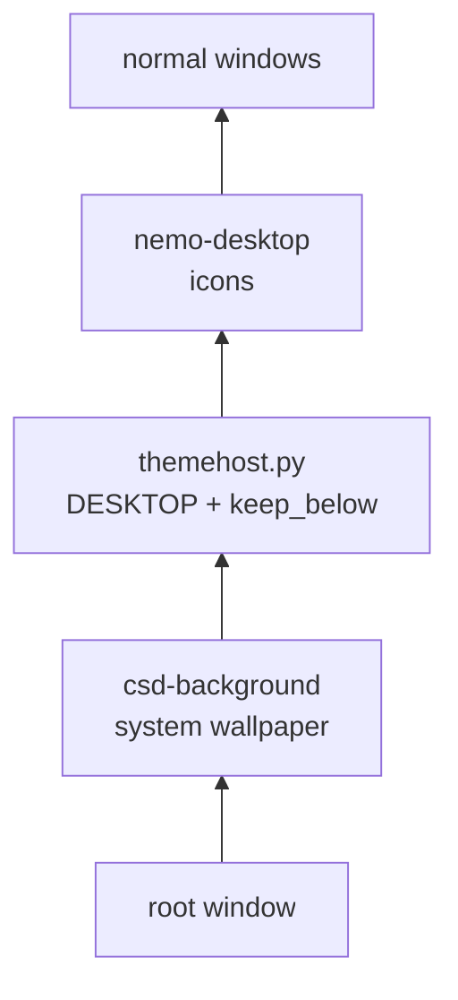
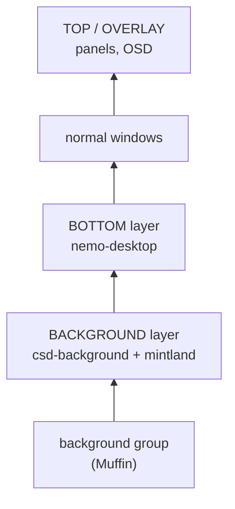

# Mintland on Wayland

**Port plan for Cinnamon 6.8+ / Muffin 6.7.5+**

> **Document:** technical analysis and work plan.  
> **Date:** 13.11.2026.  
> **Status:** research is complete, the live Wayland test is still ahead. The current machine runs X11, Cinnamon 6.6.9 and Muffin 6.6.3 — layer-shell is not available here yet.  
> **Subject:** porting Mintland from X11 to Wayland for Cinnamon 6.8+ / Muffin 6.7.5+. Scenes, `switcher.py`, `iconsource.py` and the `icons/pause/settings` protocol are carried over; the platform layer changes — `themehost.py`, the launch scripts and auto-pause.

## Contents

- [0. TL;DR](#0-tldr)
- [1. What Has Already Been Verified](#1-what-has-already-been-verified)
- [2. Architecture: How It Works Now and How It Should Work](#2-architecture-how-it-works-now-and-how-it-should-work)
- [3. Component by Component](#3-component-by-component)
- [4. Code: Dual Backend](#4-code-dual-backend)
- [5. Contested Points and Risks](#5-contested-points-and-risks)
- [6. Test Plan on Cinnamon 6.8](#6-test-plan-on-cinnamon-68)
- [7. Work Estimate](#7-work-estimate)
- [8. Recommended Order of Work](#8-recommended-order-of-work)
  - [8.1. KDE Plasma: A Separate Stage](#81-kde-plasma-a-separate-stage-not-part-of-the-cinnamon-mvp)
- [9. Conclusions](#9-conclusions)
- [10. References](#10-references)

---

## 0. TL;DR

- **There is no need to rewrite everything.** HTML/WebGL scenes, settings, themes, GIF previews, `switcher.py` and reading icon positions do not depend on X11.
- **`deskwall.c` is not needed on Wayland.** Icons are drawn by `nemo-desktop`, which in Cinnamon 6.8 itself becomes a layer-shell client of the `BOTTOM` layer. The scene must sit in the `BACKGROUND` layer — then the icons are guaranteed to be above it.
- **`xprop` and `xwininfo` do not work on Wayland** for native windows. Auto-pause has to be moved to `cinnamon-list-windows --json` or a direct D-Bus call to `org.cinnamon.Muffin.Debug.ListWindows`.
- **The main risk is not code, but the ordering inside `BACKGROUND`.** `csd-background` (the system wallpaper) lives there too. The protocol does not define the order within a single layer. If `csd-background` ends up above Mintland, the scene will not be visible. This must be checked first.
- **Multi-monitor is not "almost free".** Layer-shell gives a surface per output, but you need a separate `GtkWindow`/WebView per monitor, icon filtering per monitor and scale handling. That is a separate stage.
- **KDE/GNOME are not target platforms.** On Kubuntu/KDE the scene window will probably start (KWin supports layer-shell), but without `nemo-desktop`, `iconsource` and `cinnamon-list-windows` it will just be animated wallpaper. GNOME has no layer-shell. A full KDE backend is a separate stage (see §8.1).
- **Estimate:** 3–7 days for a single-screen MVP if the layer ordering works out; 2–3 weeks with HiDPI, multi-monitor and tests. If the `BACKGROUND` ordering does not work out — plan B via a Cinnamon extension/desklet, which is another 1–2 weeks.

---

## 1. What Has Already Been Verified

### 1.1. Current Machine

```text
$ echo $XDG_SESSION_TYPE
x11

$ cinnamon --version
Cinnamon 6.6.9

$ muffin --version
muffin 6.6.3

$ command -v cinnamon-list-windows
(none)

$ command -v wayland-info
(none)

$ ls /usr/lib/x86_64-linux-gnu/girepository-1.0/ | grep -i layer
(none)
```

This leads to an important conclusion: **the port cannot be verified live on this machine**. A Cinnamon 6.8 / Muffin 6.7.5+ session is required (the next Mint release, expected by the end of 2026; the sources mention both Mint 23 and 27 — the numbering has changed). Everything below is an analysis of upstream sources and a test plan, not a report of a live run.

### 1.2. Upstream Facts

| What | Fact | Source |
|---|---|---|
| Muffin | `wlr-layer-shell` support appeared in 6.7.0; v4 in 6.7.4; v5, HiDPI surface scaling and fixes in 6.7.5 | [changelog](https://raw.githubusercontent.com/linuxmint/muffin/master/debian/changelog), [wayland.app](https://wayland.app/protocols/wlr-layer-shell-unstable-v1) |
| Cinnamon 6.8 | Wayland stops being "experimental"; X11 remains fully supported | [Linux Mint Blog, June 2026](https://blog.linuxmint.com/?p=5046) |
| `nemo-desktop` | PR #3684 (merged 2026-03-02): on Wayland it draws icons via `gtk-layer-shell`, `BOTTOM` layer, namespace `nemo-desktop`, `exclusive_zone=0` | [nemo#3684](https://github.com/linuxmint/nemo/pull/3684) |
| `csd-background` | PR #437 (merged 2026-03-02): system wallpaper on Wayland — layer-shell, `BACKGROUND` layer, namespace `csd-background`, `exclusive_zone=-1` | [cinnamon-settings-daemon#437](https://github.com/linuxmint/cinnamon-settings-daemon/pull/437) |
| `cinnamon-list-windows` | New CLI in Muffin 6.7.5: list of windows, positions, sizes, HiDPI, backend; internally uses D-Bus `org.cinnamon.Muffin.Debug.ListWindows`, has `--json` | [muffin/src/cinnamon-list-windows](https://github.com/linuxmint/muffin/blob/master/src/cinnamon-list-windows) |
| GIR package | In Debian/Ubuntu/Mint it is called **`gir1.2-gtklayershell-0.1`**, not `gir1.2-gtk-layer-shell-0` | `apt-cache search gtk-layer-shell` |
| `wayland-info` | Contained in the **`wayland-utils`** package | `apt-cache policy wayland-utils` |

---

## 2. Architecture: How It Works Now and How It Should Work

### 2.1. X11 (current scheme)



- `themehost.py` creates a window of type `DESKTOP` and lowers it with `keep_below`.
- `nemo-desktop` draws icons on top.
- `deskwall -u` raises `nemo-desktop` so that Muffin does not place a layer above the icons.
- Auto-pause — `xprop` on `_NET_ACTIVE_WINDOW`.

### 2.2. Wayland (target scheme)



- `csd-background` and Mintland are both `BACKGROUND`; `nemo-desktop` is `BOTTOM`; normal windows are above.
- `deskwall` is not needed: the compositor sets the layer order.
- Icons are clickable because `nemo-desktop` is above Mintland.
- Auto-pause — a window list via `cinnamon-list-windows`/D-Bus, not `xprop`.

> **Important:** the order inside `BACKGROUND` is not defined by the protocol. In Muffin 6.7.x `meta_wayland_background_actor_sync_clones()` assembles surface clones in an order that depends on the implementation. This must be checked on a live Cinnamon 6.8: which one is above — `csd-background` or Mintland.

---

## 3. Component by Component

| Component | Now | On Wayland | Work |
|---|---|---|---|
| `prototype/*.html` | WebGL scenes in WebKitGTK | Unchanged; WebKitGTK 4.1 runs natively on Wayland | 0 |
| `themehost.py` — window | `DESKTOP` + `keep_below` + `lower()` + `move()` | `gtk-layer-shell`: `BACKGROUND`, anchors, `exclusive_zone=-1`, `keyboard_mode=NONE` | 1–2 days |
| `themehost.py` — icons | `xprop`, `get_xid()`, `input_shape` | remove `get_xid()`/`xprop`; input region via GDK; coordinates are logical | 1–2 days |
| `themehost.py` — pause | `xprop _NET_ACTIVE_WINDOW` | `cinnamon-list-windows --json` or D-Bus `ListWindows` | 1–2 days |
| `deskwall.c` | `-u` raises nemo | Not needed; keep only for X11 | 0.5 days for the branch |
| `wall-on.sh` | `xwininfo` waits for the window; `deskwall -u` | Wait for `run/ready`; do not call `deskwall` | 0.5–1 day |
| `wall-off.sh` | kill + restart nemo | Restarting nemo is most likely not needed; verify | 0.5 days |
| `start-layer.sh` | Requires `bin/deskwall` | Do not require it on Wayland | 0.5 days |
| `iconsource.py` | `gio` + `desktop-metadata` | Works; fix `XDG_DESKTOP_DIR` and DPI | 0.5–1 day |
| `switcher.py` | GTK3, GIF previews | Works; can show the backend | 0.5 days |
| Multi-monitor | Primary monitor only | Separate surface per output | 2–5 days |
| Tests | X11 | A machine with Cinnamon 6.8 is required | 3–5 days |

> The table is for Cinnamon. For KDE Plasma and GNOME the set of components is different: layer-shell is not available everywhere, and icons, auto-pause and the system wallpaper are arranged differently. See §5.9 and §8.1.

---

## 4. Code: Dual Backend

### 4.1. `themehost.py`: Window Setup

Idea: keep a single `ThemeHost`, but pick the platform path before `show_all()`.

```python
import os

IS_WAYLAND = os.environ.get("XDG_SESSION_TYPE") == "wayland"

def _setup_window(self):
    if IS_WAYLAND:
        try:
            gi.require_version("GtkLayerShell", "0.1")
            from gi.repository import GtkLayerShell
        except (ValueError, ImportError):
            raise RuntimeError("gtk-layer-shell GIR is not installed")

        if not GtkLayerShell.is_supported():
            raise RuntimeError("compositor does not support wlr-layer-shell")

        GtkLayerShell.init_for_window(self.win)
        GtkLayerShell.set_layer(self.win, GtkLayerShell.Layer.BACKGROUND)
        GtkLayerShell.set_namespace(self.win, "mintland")
        GtkLayerShell.set_keyboard_mode(
            self.win, GtkLayerShell.KeyboardMode.NONE)
        GtkLayerShell.set_exclusive_zone(self.win, -1)
        for edge in (GtkLayerShell.Edge.TOP, GtkLayerShell.Edge.BOTTOM,
                     GtkLayerShell.Edge.LEFT, GtkLayerShell.Edge.RIGHT):
            GtkLayerShell.set_anchor(self.win, edge, True)
        if self.monitor is not None:
            GtkLayerShell.set_monitor(self.win, self.monitor)
    else:
        self.win.set_type_hint(Gdk.WindowTypeHint.DESKTOP)
        self.win.set_keep_below(True)
```

What **not** to do on Wayland:

- `gtk_window_move()` — the position is set by anchors;
- `gdk_window_lower()` — the layer is set by the compositor;
- `gdk_window_get_xid()` — an XID exists only for X11/XWayland;
- `gtk_window_set_type_hint(DESKTOP)` and `set_keep_below()` — make no sense;
- `deskwall -u` — you cannot restack other people's windows.

### 4.2. Input Region: Clicks Must Pass Through

For wallpaper, the scene must not intercept input. On X11 `input_shape_combine_region` with an empty region is currently used. On Wayland GDK3 has input region support for its own surface; verify on Muffin 6.8.

```python
gdkwin = self.win.get_window()
if gdkwin is not None:
    empty = cairo.Region()
    # Option 1: window-level
    gdkwin.input_shape_combine_region(empty, 0, 0)
    # Option 2, if GTK overrides the shape: widget-level
    # self.win.input_shape_combine_region(empty)
```

> If the input region behaviour on Wayland turns out to be unstable, this is not a blocker for icons: `nemo-desktop` is above Mintland anyway and receives clicks. But an empty region is desirable so that the scene does not interfere with clicks on empty space and does not grab focus.

### 4.3. Layer Readiness: `run/ready` Instead of `xwininfo`

On Wayland a layer-surface has no X window, so `xwininfo -root -tree | grep mintland` will not work. The simplest contract:

```python
# themehost.py
def _on_map(self, *_):
    (RUN / "ready").write_text("1", encoding="utf-8")
    return False

self.win.connect("map-event", self._on_map)
```

```bash
# wall-on.sh
rm -f "$RUN/ready"
bash "$DIR/start-layer.sh" >>"$LOG" 2>&1
for _ in $(seq 1 40); do
    [ -f "$RUN/ready" ] && break
    sleep 0.25
done
[ -f "$RUN/ready" ] || { say "Layer did not come up"; exit 1; }
```

On X11 you can keep the old check or switch to `run/ready` as well — that is simpler.

### 4.4. Icon Coordinates: Logical Pixels

Currently `iconsource.collect()` returns logical pixels, `themehost.py` multiplies them by `self.scale`, and the page divides by `window.devicePixelRatio`. This is a double conversion which is easy to desynchronise on Wayland with fractional scaling.

It is better to add an explicit unit flag to the protocol:

```json
{"t":"icons","vis":true,"unit":"logical","r":[[l,t,r,b], ...]}
```

And fix the page (`flat.html`, `meadow.html`):

```js
// before
const k = window.devicePixelRatio || 1;
// after
const k = m.unit === 'logical' ? 1 : (window.devicePixelRatio || 1);
```

Then `themehost.py` sends logical coordinates without multiplying by `scale`, and `iconsource.py` stays in logical pixels. For HiDPI this is more reliable than guessing WebKit's `devicePixelRatio`.

Separately: `ThemeHost._detect_scale()` currently uses `xrandr`. On Wayland `xrandr` either talks to XWayland or is absent altogether; the scale must be taken from `Gdk.Monitor.get_scale_factor()` (integer) and/or from `monitor-scale` in `cinnamon-list-windows --json` (fractional). For 125/150% `Gdk` alone is not enough — a second source is needed.

### 4.5. Auto-Pause via D-Bus

`cinnamon-list-windows --json` is convenient for debugging, but for polling once a second it is better to call D-Bus directly:

```python
from gi.repository import Gio, GLib

def list_windows():
    bus = Gio.bus_get_sync(Gio.BusType.SESSION, None)
    res = bus.call_sync(
        "org.cinnamon.Muffin.Debug",
        "/org/cinnamon/Muffin/Debug",
        "org.cinnamon.Muffin.Debug",
        "ListWindows",
        None,
        GLib.VariantType.new("(aa{sv})"),
        Gio.DBusCallFlags.NONE,
        1000,
        None,
    )
    windows, = res.unpack()
    return windows


def covers_monitor(win, mon):
    if not win.get("mapped") or win.get("hidden"):
        return False
    rect = win.get("frame-rect")
    if not rect:
        return False
    x, y, w, h = rect
    return (x <= mon.x and y <= mon.y and
            x + w >= mon.x + mon.width and
            y + h >= mon.y + mon.height)
```

Practical details:

- `frame-rect` — logical coordinates; take the monitor from `Gdk.Monitor.get_geometry()`/`get_workarea()`.
- Filter by `window-type`: `DESKTOP` (Nemo) and `DOCK` (panels) must not pause the scene.
- Filter by `monitor` — on multi-monitor, each Mintland instance must look only at its own monitor.
- `hidden`, `mapped`, `workspace` — use them so as not to react to minimised/foreign workspaces.
- If `org.cinnamon.Muffin.Debug` is unavailable in the release build, fallback: `cinnamon-list-windows --json` (if the command works) or a Cinnamon extension.

> Mintland in the `BACKGROUND` layer does not create a `MetaWindow` (in Muffin `layer_wants_window()` returns `false` for `BACKGROUND`), so it will not be in `ListWindows`. The "ignore own window by PID/XID" filter is not needed on Wayland — unlike X11, where `self.xid` is compared with `_NET_ACTIVE_WINDOW`.

### 4.6. Scripts: X11/Wayland Branch

```bash
# start-layer.sh
if [ "${XDG_SESSION_TYPE:-}" = "x11" ]; then
    [ -x "$DIR/bin/deskwall" ] || notify_err "bin/deskwall is not built (see deskwall.c)"
fi
```

```bash
# wall-on.sh
if [ "${XDG_SESSION_TYPE:-}" = "x11" ]; then
    for _ in 1 2 3; do
        "$DIR/bin/deskwall" -u 2>/dev/null || true
        sleep 0.5
    done
fi
```

```bash
# wall-off.sh — on Wayland, first check whether nemo needs a restart
if [ "${XDG_SESSION_TYPE:-}" = "x11" ]; then
    pkill -x nemo-desktop 2>/dev/null || true
    setsid nemo-desktop >/dev/null 2>&1 &
fi
```

`nemo-desktop` on Wayland is a layer-shell client; after Mintland disappears it should stay in place. Restarting it is only worth doing if a test shows that the icons disappeared.

---

## 5. Contested Points and Risks

### 5.1. Ordering of `csd-background` vs Mintland in `BACKGROUND`

**Risk:** both are `BACKGROUND`; the protocol does not guarantee the order. In Muffin the order depends on the implementation; if the system wallpaper ends up above, Mintland will not be visible.

**What to do:**

1. As the first test, start `csd-background`, then Mintland, and see which one is visible.
2. Check the reverse order and a restart of `csd-background` while Mintland is running.
3. If `csd-background` is above — options:
   - re-create/re-raise the Mintland surface after `csd-background` changes;
   - use a Cinnamon extension/desklet that inserts the scene into `background_window_group` above the wallpaper but below `bottom_window_group`;
   - as a last resort — a small Muffin patch with sorting by namespace (not recommended for maintenance).

### 5.2. `nemo-desktop` on Wayland

**Risk:** in Mint 23 `nemo-desktop` should use the `BOTTOM` layer, but if the package is built without `gtk-layer-shell` or the compositor does not support the protocol, Nemo will fall back to the X11 backend. Then the icons may end up in the wrong layer.

**Check:**

```bash
wayland-info | grep -E 'zwlr_layer_shell_v1|zwlr_foreign_toplevel'
# in the cinnamon-list-windows window list, nemo-desktop must have backend wayland
cinnamon-list-windows --json | grep -A5 -i nemo
```

### 5.3. `cinnamon-list-windows` and D-Bus `org.cinnamon.Muffin.Debug`

**Risk:** the service is called `Debug`; in a release build it may be disabled or restricted. Then auto-pause will not get the window list.

**Check:**

```bash
gdbus introspect --session \
  --dest org.cinnamon.Muffin.Debug \
  --object-path /org/cinnamon/Muffin/Debug

cinnamon-list-windows --json | head
```

If the service is unavailable — a fallback is needed: a Cinnamon extension that exposes the window list, or dropping auto-pause on Wayland (undesirable).

### 5.4. HiDPI and Fractional Scaling

**Risk:** `Gdk.Monitor.get_scale_factor()` is an integer (1/2), while Cinnamon 6.8 supports 125%/150%. WebKit's `devicePixelRatio` may not match GDK. Icon positions may "drift".

**Solution:** the `unit:"logical"` protocol (see 4.4), tests at 100/125/150/200%, checking `frame-rect` and `monitor-scale` in `cinnamon-list-windows`.

### 5.5. Multi-Monitor

**Risk:** "layer-shell creates a surface per output" does not mean Mintland automatically works on all monitors. You need to:

- create a `GtkWindow`/WebView for each `Gdk.Monitor`;
- send each instance only the icons of that monitor;
- take `monitor-scale` and `frame-rect` into account;
- multiply CPU by the number of monitors.

This is a separate stage after the single-screen MVP.

### 5.6. Performance and WebKitGTK

**Risk:** WebKitGTK on Wayland may use a different compositing path; a software fallback is possible on some drivers. Auto-pause is mandatory, otherwise the scene will grind the CPU under fullscreen video.

**Check:** the same `/proc/<pid>/stat` as on X11; compare active scene and pause; verify that `WEBKIT_DISABLE_COMPOSITING_MODE` is not needed.

### 5.7. Input Region

**Risk:** GTK3 on Wayland may overwrite the input shape on realize. If the empty region is not applied, the scene may catch clicks. But since `nemo-desktop` is above, the icons remain clickable; the problem is only with clicks on empty space.

**Check:** click on an icon, right click on empty space, drag & drop of an icon, Nemo context menu.

### 5.8. XWayland Fallback

**Plus:** works without a port; `deskwall` and EWMH keep working inside XWayland.

**Minuses:**

- `xprop` does not see native Wayland windows → auto-pause "goes blind";
- the position of a `DESKTOP` window relative to native layers is a lottery;
- native Wayland windows may cover the scene in ways that are not expected.

As a temporary crutch it will do; as a solution it is worse than native layer-shell.

### 5.9. Other Compositors and Distributions: Cinnamon vs KDE vs GNOME

Layer-shell is a common protocol, but Mintland is not only layer-shell. Here is what actually carries over:

| Component | Cinnamon 6.8 / Mint | KDE Plasma 5.27+ / Kubuntu | GNOME / Ubuntu |
|---|---|---|---|
| `gtk-layer-shell` + `BACKGROUND` | ✅ | ✅ KWin supports `wlr-layer-shell`; Plasma 5.27 has `layer-shell-qt` | ❌ no layer-shell |
| WebGL scene over the wallpaper | ✅ | ⚠️ the window will start, but the ordering with the Plasma wallpaper must be tested | ❌ only an XWayland crutch |
| Desktop icons | `nemo-desktop` in `BOTTOM` | `plasmashell`; Nemo is not used | `nautilus` / `gnome-shell`; Nemo is not used |
| Icon positions | gvfs + `desktop-metadata` | `plasma-org.kde.plasma.desktop-appletsrc` (`positions=`, `ItemGeometries-*`) — a different format, unstable API | different format/API |
| Auto-pause | `cinnamon-list-windows` / D-Bus `org.cinnamon.Muffin.Debug` | KWin scripting/D-Bus; `org_kde_plasma_window_management` — a privileged interface with a declaration in `.desktop` | GNOME Shell/D-Bus or a portal; limited |
| Multi-monitor | separate surfaces per output | separate surfaces per output; Plasma specifics | limited |

Conclusion:

- **Cinnamon 6.8 / Mint 23** — the target platform; the scheme in this document is designed for it.
- **Kubuntu/KDE Plasma** — the scene will most likely start, but it will be **not Mintland, but animated wallpaper**: there is no adaptation to Plasma icons, no auto-pause, and the order relative to the system wallpaper is not guaranteed. Full operation requires a separate KDE backend (see §8.1).
- **Ubuntu/GNOME** — no layer-shell; the scheme will not work natively, only an XWayland crutch without adaptation to icons.
- **KDE/X11** — the X11 part will technically start, but `nemo-desktop`/`csd-background` are not there; that is not Mintland either.

So this will not become a universal "one button" solution. The Cinnamon path first, then — if needed — a separate KDE backend.

### 5.10. Lock Screen, Suspend/Resume, Theme Change

To check:

- whether the scene shows through on the lock screen;
- whether the surface remains after suspend/resume;
- whether the order breaks when switching between light/dark theme (csd-background may re-create the surface);
- whether Mintland calls `gsettings`/`dconf` (the SAFETY.md contract).

---

## 6. Test Plan on Cinnamon 6.8

### 6.1. Environment

```bash
echo "$XDG_SESSION_TYPE"          # wayland
cinnamon --version                # 6.8+
muffin --version                  # 6.7.5+
wayland-info | grep -i layer
cinnamon-list-windows --json | head
```

### 6.2. Basic Scenario

- [ ] `csd-background` and `nemo-desktop` are running.
- [ ] `wall-on.sh` raises Mintland in `BACKGROUND`.
- [ ] The scene is visible, icons are on top, clickable.
- [ ] `wall-off.sh` removes the scene, the icons remain.
- [ ] A repeated cycle on → off → on works.
- [ ] `zwlr_layer_shell_v1` is visible in `wayland-info`.
- [ ] In `cinnamon-list-windows`, Nemo has backend `wayland`.

### 6.3. Layer Order

- [ ] Start Mintland after `csd-background` — the scene is visible.
- [ ] Restart `csd-background` while Mintland is running — the scene did not disappear.
- [ ] Start Mintland before `csd-background` — check which one is above.
- [ ] Change the wallpaper via Dark Mode — the scene did not disappear, the order did not break.

### 6.4. Auto-Pause

- [ ] Native Wayland fullscreen Firefox window → pause.
- [ ] `mpv --gpu-context=wayland`fullscreen → pause.
- [ ] XWayland fullscreen window → pause.
- [ ] Maximised window (maximized) → pause.
- [ ] Small window in the centre → the scene runs.
- [ ] Minimised window → the scene runs.
- [ ] Window on another monitor → no effect.
- [ ] Window on another workspace → no effect.

### 6.5. HiDPI

- [ ] 100% — the icons match.
- [ ] 125% — the icons match.
- [ ] 150% — the icons match.
- [ ] 200% — the icons match.
- [ ] Scale switching on the fly — the scene redraws, the icons do not drift.

### 6.6. Multi-Monitor

- [ ] Two monitors, same scale — a scene on each.
- [ ] Two monitors, different scale — the icons match on each.
- [ ] Disconnecting/enabling a monitor — the surfaces are re-created.
- [ ] CPU does not double unnecessarily (pause on the inactive monitor).

### 6.7. Input

- [ ] Clicking an icon opens the file.
- [ ] Right click on empty space — Nemo menu, not Mintland.
- [ ] Drag & drop of an icon — works.
- [ ] Clicking the scene does not take focus.

### 6.8. Reliability

- [ ] Suspend/resume.
- [ ] Lock screen.
- [ ] Restarting Cinnamon (Alt+F2 `r`).
- [ ] Logging out/in of the session.
- [ ] `wall-off.sh` leaves no processes/surfaces behind.
- [ ] No calls to `gsettings`/`dconf` (check with `strace`/audit).

---

## 7. Work Estimate

| Stage | Optimistic | Realistic | Comment |
|---|---:|---:|---|
| `themehost.py`: layer-shell + dual backend | 1 day | 2 days | The main code is simple; the difficulty is in the branches and tests |
| `input region` + `run/ready` | 0.5 days | 1 day | GTK3 Wayland may surprise |
| Scripts: branches, dropping `deskwall`/`xwininfo` | 0.5 days | 1 day | Many small checks |
| Auto-pause: D-Bus/`cinnamon-list-windows` | 1 day | 2–3 days | Depends on the availability of `org.cinnamon.Muffin.Debug` |
| Logical icon coordinates + HiDPI | 1 day | 2 days | Tests at 125/150/200% are required |
| Multi-monitor | 2 days | 3–5 days | Separate surfaces and icon filtering |
| Tests and polish | 3 days | 5–7 days | The main thing is layer order and pause |
| **MVP total (1 monitor, 100%)** | **3–4 days** | **5–7 days** | If the `BACKGROUND` ordering works out |
| **With multi-monitor and HiDPI** | **7–10 days** | **2–3 weeks** | Without plan B |
| **Plan B: Cinnamon extension/desklet** | **+1 week** | **+2 weeks** | If `BACKGROUND` does not give the required order |
| **KDE Plasma backend** | **1–2 weeks** | **2–3 weeks** | Plasma icons + KWin auto-pause + ordering with the wallpaper; a separate stage |

---

## 8. Recommended Order of Work

1. **Do not touch the X11 path.** Keep it as the default for Mint 22.x; add `--backend auto|x11|wayland` or autodetection by `XDG_SESSION_TYPE`.
2. **First check the layer order** on Cinnamon 6.8: `csd-background` → Mintland → `nemo-desktop`. This decides whether the whole scheme is viable.
3. **Build a single-screen MVP:** `GtkLayerShell` + `BACKGROUND` + `exclusive_zone=-1` + an empty input region; without multi-monitor and without new settings.
4. **Move auto-pause** to D-Bus `ListWindows`; test on native Wayland windows.
5. **Add `unit:"logical"`** and check HiDPI.
6. **Only after that** — multi-monitor and polish.
7. **Keep the XWayland fallback** as an emergency mode, but do not advertise it as a full-fledged one.

### 8.1. KDE Plasma: A Separate Stage, Not Part of the Cinnamon MVP

If Kubuntu/KDE is needed after the Cinnamon path, it is not "enable the same backend" but a separate integration. The order of work:

1. **Check layer-shell and the layer order.** `wayland-info | grep zwlr_layer_shell_v1` (KWin supports the protocol; Plasma 5.27 has `layer-shell-qt`). Run a minimal layer-shell prototype and see which one is above — Mintland or the Plasma wallpaper.
2. **Plasma icon backend.** `iconsource.py` for Nemo does not work here. Options:
   - Plasma scripting API (`desktops()`, `widgets()`) — does not expose icon geometry directly;
   - reading `~/.config/plasma-org.kde.plasma.desktop-appletsrc` (`positions=`, `ItemGeometries-*`) — an unstable format, `plasmashell` rewrites the file on exit;
   - a custom Plasma plugin/applet that exposes icon rectangles via D-Bus. This is the most reliable, but also the most expensive path.
3. **KWin auto-pause backend.** KWin scripting/D-Bus or `org_kde_plasma_window_management`. The latter is a privileged interface: the process must declare it in an installed `.desktop` (`X-KDE-Wayland-Interfaces=...`), otherwise KWin will not provide the window list.
4. **Ordering with the system wallpaper.** If the Plasma wallpaper covers Mintland in `BACKGROUND`, plan B is not a separate window but a Plasma wallpaper plugin. That is a different architecture: WebKit/WebGL has to be embedded into the wallpaper plugin rather than into a `GtkWindow`.
5. **Multi-monitor and HiDPI** — following the same scheme as for Cinnamon, but taking the Plasma screen model into account.
6. **Tests:** Plasma icons, fullscreen video, panels, widgets, wallpaper change, multi-monitor.

Estimate: **+2–3 weeks** after the Cinnamon MVP, if the layer ordering with Plasma works out. If not — a Plasma wallpaper plugin, which is even bigger and loses part of the current architecture.

Important: while there is no KDE backend, on Kubuntu you can only run "animated wallpaper" — a scene without adaptation to icons and without proper auto-pause. That is not full-fledged Mintland.

---

## 9. Conclusions

- **Cinnamon 6.8 / Muffin 6.7.5+ is the target platform.** The `BACKGROUND` (Mintland) → `BOTTOM` (`nemo-desktop`) scheme is architecturally correct: the icons stay above the scene and are clickable.
- **The X11 path is preserved.** The Wayland backend is added as a separate branch by `XDG_SESSION_TYPE`; existing Mint 22.x users lose nothing.
- **The main risk is the order inside `BACKGROUND`.** `csd-background` and Mintland share one layer, and the protocol does not define the order. This is the first test on a live Cinnamon 6.8; whether plan B with an extension/desklet is needed depends on it.
- **Auto-pause is the second risk area.** `cinnamon-list-windows`/D-Bus `org.cinnamon.Muffin.Debug.ListWindows` must be available in the release build; otherwise a Cinnamon extension will be needed.
- **HiDPI and multi-monitor are separate stages.** This is not a "side effect" of layer-shell, but independent work with coordinates, scale and separate surfaces per output.
- **KDE Plasma requires a separate backend.** Layer-shell is available there, but icons, auto-pause and the system wallpaper are arranged differently. Without that, Kubuntu will only get animated wallpaper.
- **GNOME does not support layer-shell.** The native scheme will not work there; only an XWayland crutch without adaptation to icons remains.
- **Estimate:** a single-screen MVP — 3–7 days; the full version with HiDPI and multi-monitor — 2–3 weeks; the KDE backend — another 2–3 weeks.

---

## 10. References

- [Muffin changelog](https://raw.githubusercontent.com/linuxmint/muffin/master/debian/changelog)
- [Muffin: meta-wayland-layer-shell.c](https://github.com/linuxmint/muffin/blob/master/src/wayland/meta-wayland-layer-shell.c)
- [Muffin: meta-wayland-background-actor.c](https://github.com/linuxmint/muffin/blob/master/src/wayland/meta-wayland-background-actor.c)
- [Nemo PR #3684 — gtk-layer-shell for nemo-desktop](https://github.com/linuxmint/nemo/pull/3684)
- [cinnamon-settings-daemon PR #437 — csd-background on layer-shell](https://github.com/linuxmint/cinnamon-settings-daemon/pull/437)
- [cinnamon-list-windows source](https://github.com/linuxmint/muffin/blob/master/src/cinnamon-list-windows)
- [wlr-layer-shell protocol](https://wayland.app/protocols/wlr-layer-shell-unstable-v1)
- [gtk-layer-shell reference](https://wmww.github.io/gtk-layer-shell/)
- [Linux Mint Blog, June 2026](https://blog.linuxmint.com/?p=5046)
- [Phoronix: Wayland no longer experimental for Cinnamon](https://www.phoronix.com/news/LinuxMint-Cinnamon-Wayland-Good)
- [KWin layer-shell integration](https://lxr.kde.org/source/plasma/kwin/src/layershellv1integration.cpp?v=stable-kf6-qt6)
- [Plasma scripting API](https://develop.kde.org/docs/plasma/scripting/api/)
- [Plasma desktop icon positions](https://askubuntu.com/questions/1387893/where-does-kde-plasma-store-the-user-specified-arrangement-of-desktop-icons)

---

## Appendix A. Quick Environment Check

```bash
# 1. Session and versions
echo "$XDG_SESSION_TYPE"
cinnamon --version
muffin --version

# 2. Layer-shell
sudo apt install wayland-utils
wayland-info | grep -E 'zwlr_layer_shell_v1|zwlr_foreign_toplevel'

# 3. GIR for Python
sudo apt install gir1.2-gtklayershell-0.1
python3 -c 'import gi; gi.require_version("GtkLayerShell","0.1"); from gi.repository import GtkLayerShell; print(GtkLayerShell.is_supported())'

# 4. Window list
cinnamon-list-windows --json | head -40
gdbus introspect --session --dest org.cinnamon.Muffin.Debug \
  --object-path /org/cinnamon/Muffin/Debug

# 5. Nemo
pgrep -a nemo-desktop
cinnamon-list-windows --json | grep -A8 -i nemo
```

## Appendix B. Minimal layer-shell Prototype

```python
#!/usr/bin/env python3
import gi
gi.require_version("Gtk", "3.0")
gi.require_version("GtkLayerShell", "0.1")
from gi.repository import Gtk, GtkLayerShell

win = Gtk.Window()
win.set_decorated(False)
GtkLayerShell.init_for_window(win)
GtkLayerShell.set_layer(win, GtkLayerShell.Layer.BACKGROUND)
GtkLayerShell.set_namespace(win, "mintland-test")
GtkLayerShell.set_keyboard_mode(win, GtkLayerShell.KeyboardMode.NONE)
GtkLayerShell.set_exclusive_zone(win, -1)
for edge in (GtkLayerShell.Edge.TOP, GtkLayerShell.Edge.BOTTOM,
             GtkLayerShell.Edge.LEFT, GtkLayerShell.Edge.RIGHT):
    GtkLayerShell.set_anchor(win, edge, True)

win.add(Gtk.Label(label="Mintland layer-shell test"))
win.connect("destroy", Gtk.main_quit)
win.show_all()
Gtk.main()
```

Run it on Cinnamon 6.8/Wayland. If the window is visible above the wallpaper but below the icons — the basic scheme works. If the window is not visible — most likely `csd-background` covers it in `BACKGROUND`; that is the first bug to investigate.
